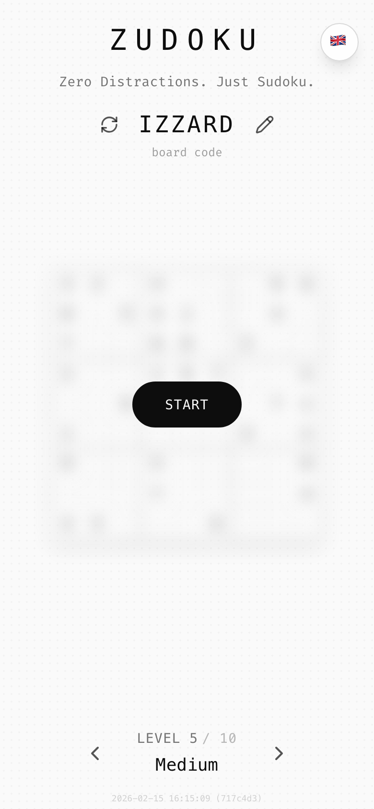
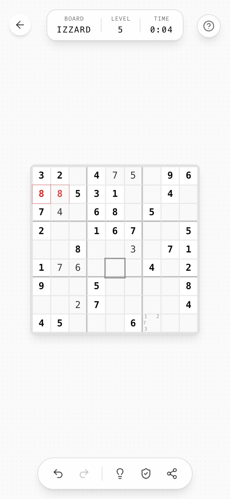
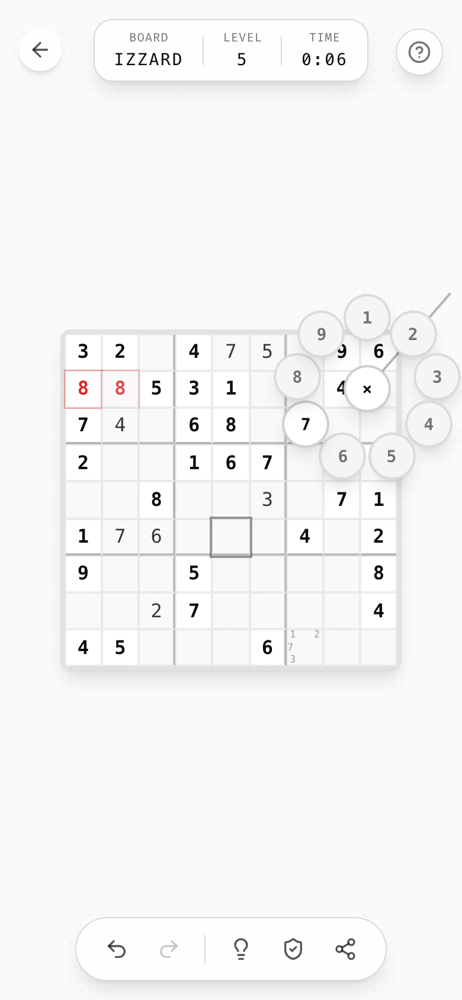

# Ztyle — the izzardry style guide

**Ztyle** is the house style for every game published under **izzardry**.
It was extracted from **[Zudoku](https://github.com/holzschneider/zudoku)**, the first izzardry title.
Zudoku is the reference implementation: when this guide is silent, do what Zudoku does. Where Zudoku departs from this guide, the guide wins. Those departures are listed in [the Zudoku audit](docs/90-zudoku-audit.md).

<p align="center">
  
  
  
</p>

**→ Live: [izzardry.github.io/ztyle](https://izzardry.github.io/ztyle/)** (source: [`index.html`](index.html)): a single static page that teaches the whole style step by step, with live demos (stage transition, radial dial, long-press ladder, synced pulses, undo toasts) built from the real tokens. The markdown chapters below are the detailed reference.

## The idea in one line

> **Zero Distractions. Just _the game_.**

An izzardry game is a monochrome, monospaced, paper-quiet surface with the game board in the middle. Everything else floats on top of it, shows up only when needed and gets out of the way. No ads, no accounts, no noise.

## The ten rules

1. **The board is the hero.** It is always centered and never moves between screens. Menus and chrome fade in around it ([layout](docs/05-layout.md)).
2. **Grayscale first.** All UI is neutral gray (hue 0, saturation 0). Color is reserved for *meaning*: red = conflict, green = success ([color](docs/03-color.md)).
3. **Everything is monospace.** One mono typeface for every word and number. Uppercase plus wide tracking for labels, `font-light` for display text ([typography](docs/04-typography.md)).
4. **Pills and circles.** Buttons are fully rounded. Panels are `rounded-2xl` glass ([surfaces](docs/06-surfaces.md)).
5. **Chrome floats.** Toolbars are translucent cards (`bg-card/80 backdrop-blur-sm`) pinned to the screen edges and safe areas. Tapping the background hides them all.
6. **Motion explains, never decorates.** Fade plus a short slide, ease-out, 150–500 ms. Screen changes blur the board in and out ([motion](docs/07-motion.md)).
7. **Touch is first-class.** Use gestures where they beat buttons (long-press, drag-to-dial, swipe-to-delete), and always offer a mouse or keyboard path too ([interaction](docs/08-interaction.md)).
8. **Every puzzle has a code.** Content is generated deterministically from a short, shareable, uppercase **board code**. The URL *is* the save game ([persistence & sharing](docs/11-persistence-and-sharing.md)).
9. **Forgiving by default.** Undo everything. Autosave everything. Deletions get an undo toast. Helpers can be switched off, but are on by default ([feedback](docs/09-feedback.md)).
10. **Ship as a PWA, on the web, for free.** Installable, offline-capable, localized, and supported by an optional, once-only donation ask ([platform](docs/12-platform-pwa.md), [monetization](docs/13-monetization.md)).

## Contents

| # | Chapter | What's in it |
|---|---------|--------------|
| 01 | [Brand](docs/01-brand.md) | izzardry, game naming, tagline formula, wordmark, icon, OG image |
| 02 | [Principles](docs/02-principles.md) | Design principles, with the Zudoku decisions behind each |
| 03 | [Color](docs/03-color.md) | Token table (HSL + hex, light + dark), alpha ladder, semantic colors |
| 04 | [Typography](docs/04-typography.md) | Typeface, type scale, tracking, casing rules |
| 05 | [Layout](docs/05-layout.md) | Board-centric layout, portrait/landscape, safe areas, z-index scale |
| 06 | [Surfaces](docs/06-surfaces.md) | Radius, borders, shadows, glass, halftone texture, iconography |
| 07 | [Motion](docs/07-motion.md) | Durations, easings, keyframes, screen transitions, stagger |
| 08 | [Interaction](docs/08-interaction.md) | Long-press ladder, radial dial, swipe, keyboard, hide-UI tap |
| 09 | [Feedback & states](docs/09-feedback.md) | Selection, conflict, hint, completion, toasts, undo, loading |
| 10 | [Components](docs/10-components.md) | Specs for every reusable UI piece |
| 11 | [Persistence & sharing](docs/11-persistence-and-sharing.md) | Board codes, URL state, autosave, storage keys, history |
| 12 | [Platform & PWA](docs/12-platform-pwa.md) | Manifest, icons, meta tags, updates, version stamp, deploy |
| 13 | [Monetization](docs/13-monetization.md) | No ads, the donation prompt, the easter egg |
| 14 | [Copy & i18n](docs/14-copy-and-i18n.md) | Voice, casing, string patterns, translation setup |
| 15 | [Onboarding](docs/15-onboarding.md) | The coach-mark tutorial overlay |
| 16 | [Accessibility](docs/16-accessibility.md) | Labels, focus, contrast, reduced motion |
| 17 | [Tech stack](docs/17-tech-stack.md) | Reference stack, project layout, conventions |
| 90 | [Zudoku audit](docs/90-zudoku-audit.md) | Where Zudoku departs from this guide, and the fixes |
| ✓ | [Launch checklist](docs/99-launch-checklist.md) | Go/no-go list for a new izzardry game |

## Drop-in tokens

| File | Use it when |
|------|-------------|
| [`tokens/ztyle.css`](tokens/ztyle.css) | Any web project. Plain CSS: variables, base, component classes. No build step. |
| [`tokens/tailwind.preset.ts`](tokens/tailwind.preset.ts) | Tailwind 3 projects (the reference stack). Use together with `ztyle.css`. |
| [`tokens/ztyle.tokens.json`](tokens/ztyle.tokens.json) | Non-web targets (native, game engines, design tools). |
| [`index.html`](index.html) | The guide as one page: open it locally, or host it with GitHub Pages (root of `main`). Uses only `ztyle.css`. |

```ts
// tailwind.config.ts
import ztyle from "./ztyle/tokens/tailwind.preset";
export default { presets: [ztyle], content: ["./index.html", "./src/**/*.{ts,tsx}"] };
```

```css
/* src/index.css */
@import "./ztyle/tokens/ztyle.css";
@tailwind base; @tailwind components; @tailwind utilities;
```

## Open decisions

These came up during extraction and need a call from the owner. Until then, the guide uses the default marked ★.

- **Typeface.** ★ Self-host **Fira Code** (what Zudoku looks like on the creator's machine), or pick JetBrains Mono. Today, other visitors get whatever mono font their system happens to have. See [typography](docs/04-typography.md).
- **App icon language.** The Zudoku icon (cream tile, slate frame, sprout glyph) and OG image (navy gradient, Courier) don't match the grayscale UI. ★ Bring both into the grayscale system. Is the sprout an izzardry mark to keep? See [brand](docs/01-brand.md).
- **Dark mode.** The dark tokens exist but are never turned on in Zudoku. ★ Follow the system setting. See [color](docs/03-color.md).
- **Z-naming.** *Zudoku* and *Ztyle* suggest a "swap the first letter for Z" convention. ★ Treat it as the default naming pattern. See [brand](docs/01-brand.md).
