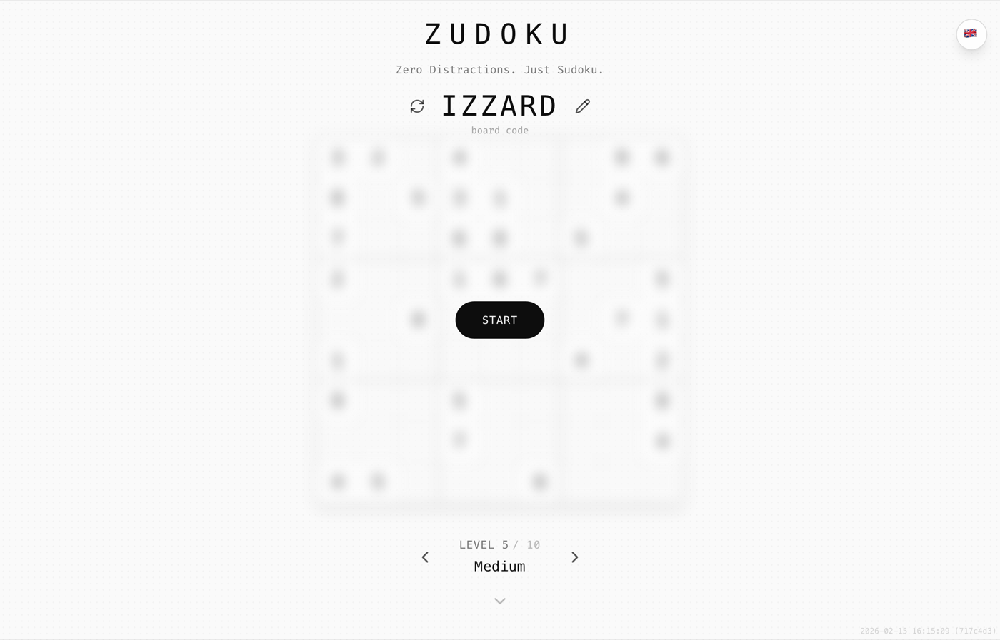
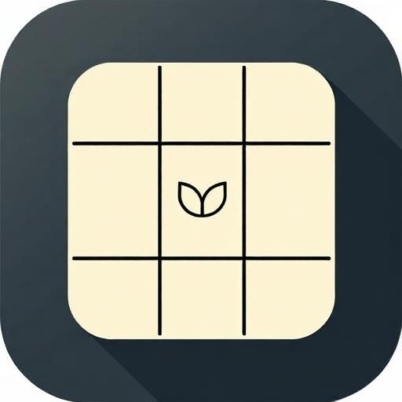
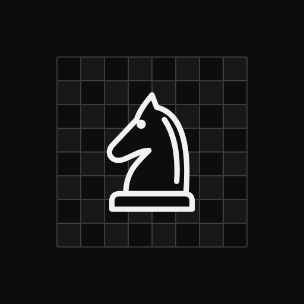
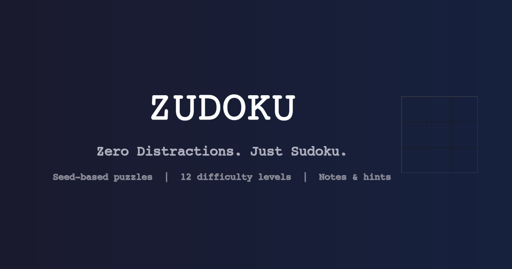
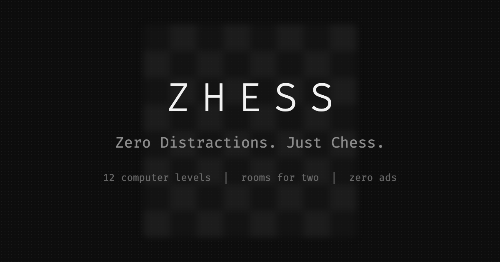

# 01 · Brand

## izzardry

**izzardry** is the publisher label. It is always written in lowercase, even at the start of a sentence or in a title ("an izzardry game"). It stays in the background: the *game* is the product, and izzardry is the quiet signature beneath it.

Where izzardry appears:

| Place | Treatment |
|-------|-----------|
| `<meta name="author">` | `izzardry` |
| Footer of the history/scroll area (optional) | `an izzardry game` · `text-[10px] text-muted-foreground/40`, lowercase |
| GitHub org / repo | `github.com/izzardry/<GameName>` |
| Donation link | Personal ("support me as an independent developer"). izzardry is a person, not a corporation. |

> Zudoku currently sets `author` to `holzschneider` and links Buy Me a Coffee to `holzschneider`. That's fine for the person; for the label, prefer `izzardry` in metadata. Zhess does exactly that: `author` is `izzardry`, the coffee link stays personal, and the scroll area ends with `an izzardry game`.

## Game naming

Observed pattern: **swap the first letter of a familiar word for a Z.**

| Familiar word | izzardry name |
|---------------|---------------|
| Sudoku | **Zudoku** |
| Chess | **Zhess** |
| Style | **Ztyle** |

Rules for new names:

- One word, pronounceable, recognizably the classic it riffs on (Zolitaire, Zinesweeper, Zokoban, Zonogram…).
- Wordmark is UPPERCASE with very wide tracking: `Z U D O K U`, `Z H E S S`.
- In running text, use Capitalized form: "Zudoku", "Zhess".
- `short_name` in the PWA manifest = the bare name (≤ 12 chars).

## Tagline formula

> **Zero Distractions. Just _\<Game\>_.**

The tagline is part of the brand. Z is for **Zero**: the Z in the name and the Z in "Zero" rhyme on purpose.

- Two sentences, each ending with a period. Title-ish capitalization: `Zero Distractions. Just Sudoku.`
- Use it verbatim (not translated) under the wordmark on the start screen, in `<title>`, OG/Twitter titles and the manifest `name`.
- Page title format: `Zudoku - Zero Distractions. Just Sudoku.` · `Zhess - Zero Distractions. Just Chess.`
- Meta description format: `Zero Distractions. Just Sudoku. A minimalist seed-based Sudoku puzzle game.`
- OG description format: `A minimalist seed-based Sudoku puzzle game. 12 difficulty levels, notes, hints, and zero ads.` (One sentence on what it is, then a comma list of 3–4 features, ending in **"and zero ads."**) Zhess: `A minimalist chess game. 12 computer levels, serverless rooms for two, a chess clock, and zero ads.`

## Wordmark

The wordmark is plain text. There is no logo file.

```html
<h1 class="font-mono font-light tracking-[0.3em] text-3xl sm:text-4xl">ZUDOKU</h1>
```

| Property | Value |
|----------|-------|
| Case | UPPERCASE (typed in caps, not `text-transform`, so it stays caps in every language) |
| Weight | 300 (`font-light`) |
| Tracking | `0.3em` |
| Size | 30 px mobile → 36 px ≥ 640 px. 24 px in mobile landscape. 20 px in the sticky header. |
| Color | `foreground` |

Below it sits the tagline: `text-sm text-muted-foreground mt-2` (`text-xs mt-1` in landscape).



## App icon

**Current Zudoku icon** (`assets/reference/zudoku-app-icon.jpg`): a cream rounded tile on a dark slate rounded-square, thin black 3×3 grid, a small sprout glyph in the center, and a long flat shadow.



It works as an icon, but it uses warm cream and slate-blue, which appear nowhere in the UI. The izzardry icon standard going forward:

| Property | Standard |
|----------|----------|
| Canvas | 512 × 512 PNG (real PNG, not a renamed JPEG), plus 192 × 192, plus a 512 maskable variant with 20 % safe padding |
| Background | `#0d0d0d` (foreground) full-bleed, or `#fafafa` (background) |
| Motif | The game's board/grid drawn in thin strokes in the opposite neutral. A single focal glyph in the center is allowed. |
| Color | Grayscale. One accent is allowed only if it is a semantic color (success green) and is used sparingly. |
| Effects | No gradients, no glossy highlights. A long flat shadow is tolerated, but flat is preferred. |
| Family resemblance | Every izzardry icon = same frame, same stroke weight, different grid/motif. |

**Open question:** is the sprout glyph meant as an izzardry mark? If yes, put it in the center cell of every game's icon and keep it the *only* non-gray element.

**Zhess is the first icon made to this standard**: a `#0d0d0d` tile, a faint 8×8 grid in thin strokes, and one knight from the game's own piece set in the center. No sprout, no color.



**Draw the icon and the OG image from code.** Zhess renders both with a script (`scripts/generate-brand-images.mjs`, headless Chromium) from the same SVG pieces the board uses. The brand images then never drift from the game, and a new size is one command.

## Social / OG image

**Current Zudoku OG image** (`assets/reference/zudoku-og-image.png`): a navy gradient, a Courier-style serif mono font, and a faint 3×3 grid at the right.



The izzardry standard (1200 × 630):

- Background `#0d0d0d` with the halftone dot texture (`foreground/6 %` dots on a 8 px grid), or the light variant `#fafafa`.
- Wordmark centered: brand mono, weight 300, tracking 0.3em, ~96 px, `#f2f2f2`.
- Tagline below in `muted-foreground` (`#8c8c8c`), ~36 px.
- Feature line: 3 items separated by `  |  `, ~24 px, `muted-foreground` at 70 %.
- Optional: a real screenshot of the board, blurred 8 px at 60 % opacity, exactly like the start screen. This is the most recognizable izzardry image.

Zhess follows this to the letter: dark tile, halftone dots, a blurred board behind the wordmark, and the feature line `12 computer levels | rooms for two | zero ads`.



Point `og:image` and `twitter:image` at the **absolute** URL of the deployed file and add `og:url`. Crawlers do not resolve a relative path against the page (see [platform](12-platform-pwa.md#indexhtml-head-template)).
