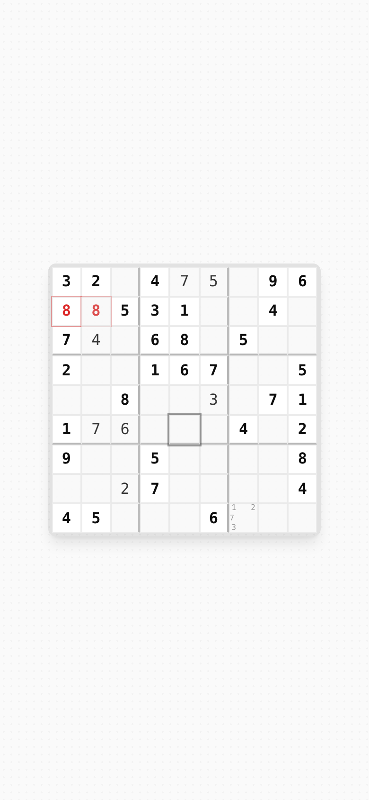

# 02 · Principles

Each principle is followed by the concrete Zudoku decision it came from. When a new game has to make a call this guide doesn't cover, reason from these.

## 1. Zero distractions

The game screen contains the board and nothing that isn't needed *right now*.

- Chrome is translucent, floats at the screen edges and **hides entirely when you tap the background** (`showUI` toggle).
- The version stamp, language switcher, install button, history and donation button exist **only on the start screen** and disappear the moment the game begins.
- No sound, no confetti animation, no streaks, no badges, no notifications, no timers pressuring you (the clock is shown, never used against you).
- Celebration is a single emoji (🎉) and two buttons.

## 2. The board never moves

The board is in the same place, at the same size, on the start screen and in game. On the start screen it is a **blurred preview** (`blur(8px)`, 60 % opacity) of the exact puzzle the current board code will produce. Pressing **Start** un-blurs it in place over 500 ms. Nothing navigates; the UI around it changes.

This gives you:
- no page transitions to design,
- an instant, honest preview ("this is what you'll get"),
- a sense of a single, calm object you return to.

## 3. Monochrome is the brand

Neutral grays carry all the structure. Color only ever means something:

| Color | Meaning | Never used for |
|-------|---------|----------------|
| Red (`destructive`) | A rule is broken / destructive hover | Decoration, branding, primary buttons |
| Green (`success`) | Something is done or correct (box complete, puzzle solved, hint placed) | Generic "go" buttons |
| Amber | Exists only inside the donation dialog (coffee) | Anything in gameplay |

## 4. Mono type, quiet hierarchy

Hierarchy comes from **size, weight, case and tracking**, not from font changes or color. Labels whisper (10 px, uppercase, muted); values speak (mono, wide tracking, foreground).

## 5. Deterministic and shareable

Every puzzle comes from a short **board code** (`IZZARD`). Same code + same level = same puzzle, for everyone, forever. The whole game state lives in the URL, so sharing a link shares the game, with or without progress.

## 6. Forgiving

- Unlimited undo/redo.
- Autosave on every move; resume from history.
- Deleting history items is instant **and** undoable (5 s toast, "Undo All" when stacked).
- Helpers ("safety mode": conflict highlighting, blocking of impossible digits) are **on** by default and can be toggled off for purists.
- Hints are free. Holding the hint button **peeks** at the full solution only while held.

## 7. Touch-native, keyboard-complete

Gestures are designed for the thumb (radial dial on long-press, swipe-to-delete, tap-background-to-hide). Every gesture has a pointer/keyboard equivalent (click + `1`–`9`, `Shift`+digit for notes, hover × to delete).

## 8. Respect the person

- No ads, no account, no tracking.
- The donation ask appears **once**, after the first completed game, and says "maybe another time" instead of "No thanks".
- First-run tutorial appears once and is dismissed by tapping anywhere.
- The install prompt appears once; after "Not now" only a small install pill remains.

## 9. Honest progress

Heavy work (puzzle generation, seed search) runs in Web Workers. The UI shows a spinner in place of the control that started it, a tooltip with real numbers (`Tried: 312 seeds`), and tapping the spinner cancels. Nothing blocks the main thread.

## 10. Small surface, deep feel

Few features, each polished on the details that make it feel good: synchronized error pulses, digits that grow under the finger, a rubber-band line in the dial, cards that collapse their height after a swipe. When in doubt, cut a feature and polish one.
