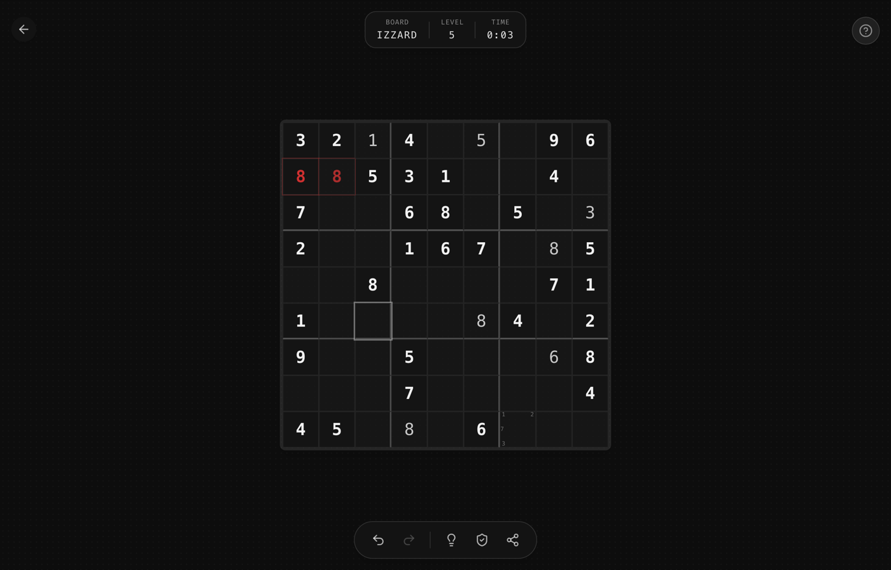

# 03 · Color

## System

- Tokens are **HSL triplets without `hsl()`** in CSS custom properties (`--background: 0 0% 98%`), so alpha can be applied anywhere: `hsl(var(--foreground) / 0.1)`, or in Tailwind `bg-foreground/10`.
- All neutrals have **hue 0, saturation 0**: true gray, no blue or warm tint.
- Light and dark are **mirror images**. `primary` equals `foreground` (black in light, white in dark). There is no brand color.
- Dark mode is applied with the `.dark` class on `<html>`. The default is to **follow the system** (`prefers-color-scheme`). See [Dark mode](#dark-mode).

## Tokens

| Token | Role | Light HSL | Light hex | Dark HSL | Dark hex |
|-------|------|-----------|-----------|----------|----------|
| `background` | Page | `0 0% 98%` | `#fafafa` | `0 0% 5%` | `#0d0d0d` |
| `foreground` | Text, ink, strokes | `0 0% 5%` | `#0d0d0d` | `0 0% 95%` | `#f2f2f2` |
| `card` | Raised surfaces, cells | `0 0% 100%` | `#ffffff` | `0 0% 8%` | `#141414` |
| `card-foreground` | | `0 0% 5%` | `#0d0d0d` | `0 0% 95%` | `#f2f2f2` |
| `popover` | Menus, popovers | `0 0% 100%` | `#ffffff` | `0 0% 8%` | `#141414` |
| `primary` | Primary button fill | `0 0% 5%` | `#0d0d0d` | `0 0% 95%` | `#f2f2f2` |
| `primary-foreground` | | `0 0% 98%` | `#fafafa` | `0 0% 5%` | `#0d0d0d` |
| `secondary` | | `0 0% 92%` | `#ebebeb` | `0 0% 15%` | `#262626` |
| `secondary-foreground` | | `0 0% 15%` | `#262626` | `0 0% 90%` | `#e6e6e6` |
| `muted` | Quiet fills, disabled | `0 0% 96%` | `#f5f5f5` | `0 0% 12%` | `#1f1f1f` |
| `muted-foreground` | Secondary text, labels | `0 0% 45%` | `#737373` | `0 0% 55%` | `#8c8c8c` |
| `accent` | Hover fill, "note" state | `0 0% 90%` | `#e6e6e6` | `0 0% 18%` | `#2e2e2e` |
| `accent-foreground` | | `0 0% 10%` | `#1a1a1a` | `0 0% 95%` | `#f2f2f2` |
| `border` / `input` | Hairlines | `0 0% 85%` | `#d9d9d9` | `0 0% 20%` | `#333333` |
| `ring` | Focus ring | `0 0% 5%` | `#0d0d0d` | `0 0% 80%` | `#cccccc` |
| `destructive` | Conflict, error, delete-hover | `0 72% 51%` | `#dc2828` | `0 62% 50%` | `#cf3030` |
| `destructive-foreground` | | `0 0% 98%` | `#fafafa` | `0 0% 98%` | `#fafafa` |
| `success` | Solved, complete, hint | `142 76% 36%` | `#16a249` | `142 70% 45%` | `#22c35d` |
| `success-foreground` | | `0 0% 98%` | `#fafafa` | `0 0% 98%` | `#fafafa` |

Base radius `--radius: 0.5rem` (see [surfaces](06-surfaces.md)).

## The alpha ladder

Most of the visual nuance comes from **foreground at low alpha**, not from extra gray tokens. Use these steps and nothing in between:

| Alpha | Use |
|-------|-----|
| `foreground/3` | Halftone dot texture (page) |
| `foreground/5` | Highlight of related cells (same row/col/box), ghost-button hover |
| `foreground/6` | Dense halftone |
| `foreground/10` | Board frame fill, selected cell fill, icon-button hover |
| `foreground/20` | Ghost button border, radial item border |
| `foreground/30` | Block dividers (thick grid lines), card hover border, radial note ring, input underline |
| `foreground/40–50` | Note digits, selection ring, noted ring in dial |
| `foreground/60` | User-entered digits in thumbnails |
| `foreground/70` | Icon-button resting icon color |

`muted-foreground` alpha steps for text: **/70** (sub-label), **/60** (dismiss links, tap hint), **/50** (chevron hint, "/ 10" suffix), **/40** (disabled toggle icon), **/30** (version stamp).

Translucent surfaces: `card/80` (floating chrome), `card/90` (back-to-top), `card/95` (tutorial bubbles), `background/95` (sticky header), `background/80` (completion scrim), `background/60` (tutorial scrim).

## Semantic color usage

| State | Recipe |
|-------|--------|
| Conflict cell | text `destructive` semibold, fill `destructive/15`, `ring-1 ring-destructive/40`, inset glow pulse (`destructive/15 → /30`) |
| Completed group (box/row/region) | fill `success/5` (barely there) |
| Board solved | page background tints to `success/12` over 1000 ms |
| Board full but wrong | page background tints to `destructive/12` over 1000 ms |
| Hint placed | `success` pulse: fill `success/30 → 0`, ring `0 → 8px`, 800 ms, once |
| Solved marker in lists | `✓` in `text-success font-mono text-xs` |
| Delete affordance hover | `hover:text-destructive hover:border-destructive/50` |

Tinting the **whole page** for the end state is a signature move. Use it for any game's win/lose result instead of a modal color.

## Off-system colors

- **Amber** (`amber-100`/`amber-600`, dark `amber-900/30`/`amber-400`) is used only for the coffee icon disc in the donation dialog.
- The Buy Me a Coffee button image keeps its own yellow. It is a third-party badge, so leave it as is.
- Never use the default browser focus color (blue). See [accessibility](16-accessibility.md).

## Dark mode



The dark palette is complete and looks right (above: Zudoku with `.dark` forced on). Ship it by following the OS setting:

```ts
// main.tsx, before render
const mq = window.matchMedia("(prefers-color-scheme: dark)");
const apply = () => document.documentElement.classList.toggle("dark", mq.matches);
apply(); mq.addEventListener("change", apply);
```

Also update `<meta name="theme-color">` to match: `#fafafa` in light, `#0d0d0d` in dark (use two meta tags with `media="(prefers-color-scheme: …)"`).

A manual toggle is optional. If added, it is an icon-button (`Sun`/`Moon`) on the start screen next to the language switcher, never in game.
