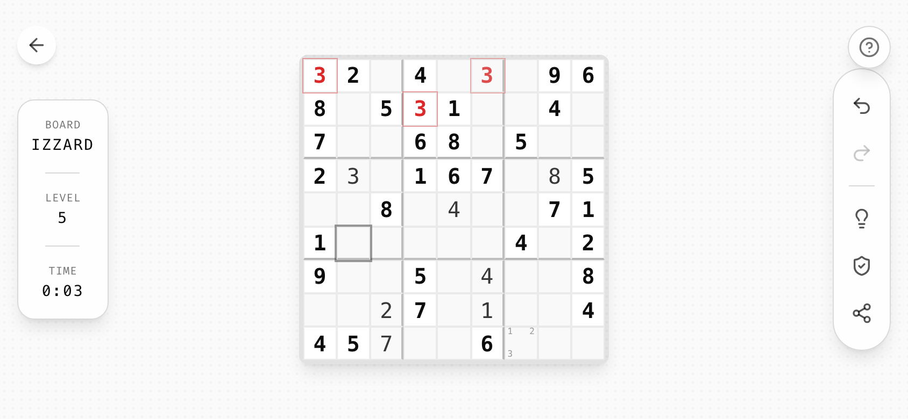
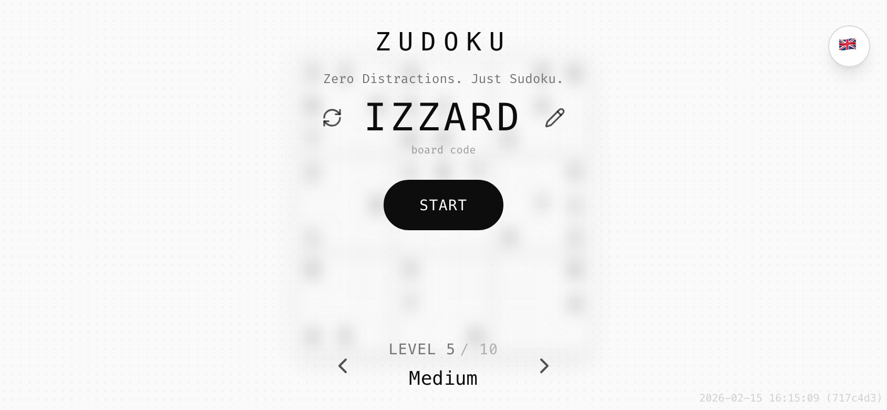

# 05 · Layout

## The stage

```
┌──────────────────────────────────────────┐
│ (←)        [ BOARD │ LEVEL │ TIME ]   (?) │  ← floating chrome, top
│                                          │
│                                          │
│              ┌──────────────┐            │
│              │              │            │
│              │    BOARD     │  ← always centered, never moves
│              │              │            │
│              └──────────────┘            │
│                                          │
│        [ ↶  ↷ │ 💡  🛡  ⇪ ]               │  ← floating toolbar, bottom
└──────────────────────────────────────────┘
```

- The page is a single full-viewport stage: `min-h-screen flex items-center justify-center p-4`.
- The board sits dead center at all times: start screen, game, transitions.
- All other UI is `position: fixed` and **overlays** the stage. Nothing pushes the board around.
- In game, the page is locked (`h-screen overflow-hidden touch-none`). On the start screen it is `min-h-[200vh]`, so scrolling down reveals the history.

## Screens

There is one route. "Screens" are states of the same stage:

| State | Board | Visible UI |
|-------|-------|------------|
| **Start** | Blurred preview (8 px, 60 %) | Wordmark + tagline + code selector (top), **Start** pill (center, over board), level selector + install pill + bounce chevron (bottom), language (top-right), version (bottom-right) |
| **Start → scrolled** | Blurred | Sticky wordmark header, history list, back-to-top FAB, donation button |
| **Game** | Sharp, interactive | Back (top-left), stats pill (top-center portrait / left rail landscape), help (top-right), toolbar (bottom portrait / right rail landscape) |
| **Game, UI hidden** | Sharp | Nothing but the board |
| **Overlay** | Blurred behind scrim | Completion / tutorial / dialog |

## Portrait vs. landscape

Mobile landscape is detected as `innerWidth > innerHeight && min(innerWidth, innerHeight) < 768`. Desktop wide screens stay in "portrait" layout.

| Element | Portrait | Mobile landscape |
|---------|----------|------------------|
| Stats | Horizontal pill, top-center, `h-6 w-px` dividers | Vertical card, left-center rail, `w-8 h-px` dividers |
| Toolbar | Horizontal pill, bottom-center | Vertical pill, right-center rail |
| Toolbar divider | `w-px h-6 mx-1` | `h-px w-6 my-1` |
| Hide direction | Top items slide **up**, bottom items slide **down** | Left rail slides **left**, right rail slides **right** |
| Text sizes | normal | One step smaller (`text-2xl` wordmark, `text-[10px]` sub-labels) |
| Tutorial | 3 rows | 3 columns |

<p>


</p>

## Board sizing

The board is sized from one variable so it fits any viewport without scrolling:

```css
--cell-size: clamp(28px, min(8vw, 8vh), 52px);
```

For a 9×9 board this keeps it ≤ 72 % of the short side. For other grid sizes use `min(Nvw, Nvh)` with `N ≈ 72 / columns`. The board frame is `p-1 bg-foreground/10 rounded-lg shadow-lg`. On mobile it has `mx-4` so pop-out UI (the radial dial) has room.

## Safe areas

Every edge-pinned element uses `max(<design inset>, env(safe-area-inset-<side>))`. `viewport-fit=cover` is set in the viewport meta.

| Edge element | Inset |
|--------------|-------|
| Top chrome (back, help, language) | `top-[max(1.5rem,env(safe-area-inset-top))]` |
| Top info pill / start header | `top-[max(1rem,env(safe-area-inset-top))]` |
| Side chrome | `left/right-[max(1rem,env(safe-area-inset-left/right))]` |
| Bottom toolbar | `bottom: max(1rem, env(safe-area-inset-bottom))` |
| Bottom FAB / toasts | `bottom-[max(1.5rem,calc(env(safe-area-inset-bottom)+0.5rem))]` |
| Start footer | `bottom-[max(2rem,calc(env(safe-area-inset-bottom)+1rem))]` |
| Version stamp | `bottom-[max(0.25rem,env(safe-area-inset-bottom))]` |

## Content width

- Lists, history, full-screen sheets: `max-w-md mx-auto px-4`.
- Toasts: `w-[min(90vw,360px)]`.
- Install prompt card: `max-w-sm`.
- Tutorial bubbles: `max-w-[200px]` (`180px`/`160px`/`140px` for tighter slots).

## Spacing rhythm

Tailwind 4 px scale. The common steps are:

- `gap-2` between toolbar buttons, `gap-3` in the code selector, `gap-4` in level selector / stats pill / cards.
- `px-4 py-2` pills, `px-4 py-3` toasts and bubbles, `p-4` cards, `p-8` celebration.
- Vertical stacks: `mt-1`/`mt-2` label→value, `mt-4` group→group, `mt-6` before a hint chevron, `mb-6` before a list, `space-y-2` between list cards.

## Z-index scale

| z | Layer |
|---|-------|
| 0 | Cell value text |
| 10 | Start overlay (Start button over board); selected cell (+`z-40` while selected) |
| 20 | Start header/footer; conflict cells |
| 30 | Sticky history header, back-to-top FAB; cells with user values |
| 40 | Floating game chrome (stats, toolbar, help, language) |
| 50 | Back button, overlays (completion, install prompt, full-screen list), toasts, radial dial, version stamp |
| 100 | Tutorial overlay |

Pop-up UI that must escape a `filter`/`transform` stacking context (the radial dial under the blurred board) is **portaled to `document.body`**.

## Breakpoints

Tailwind defaults (`sm 640`, `md 768`, `lg 1024`), plus a JS `MOBILE_BREAKPOINT = 768` for behavior (swipe vs. hover, show donation button only after scrolling). Distinguish *touch devices* by `(pointer: coarse) and not (pointer: fine) and not (hover: hover)`, not by width.
