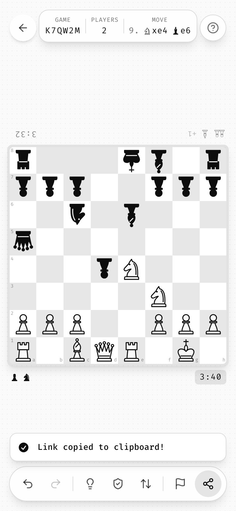
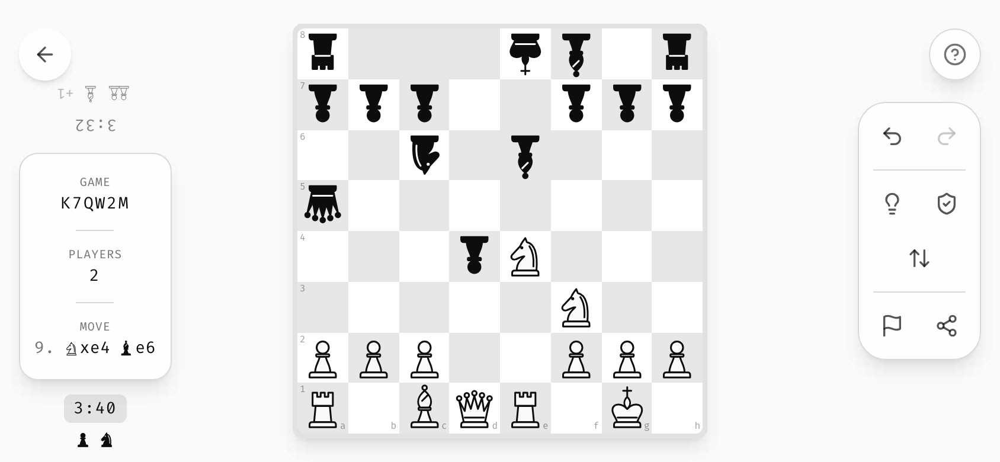

# 05 · Layout

## The stage

```
┌──────────────────────────────────────────┐
│ (←)        [ BOARD │ LEVEL │ TIME ]   (?) │  ← floating chrome, top
│                                          │
│                                          │
│              ┌──────────────┐            │
│              │              │            │
│              │    BOARD     │  ← always centered, never moves
│              │              │            │
│              └──────────────┘            │
│                                          │
│        [ ↶  ↷ │ 💡  🛡  ⇪ ]               │  ← floating toolbar, bottom
└──────────────────────────────────────────┘
```

- The page is a single full-viewport stage: `min-h-screen flex items-center justify-center p-4`.
- The board sits dead center at all times: start screen, game, transitions.
- All other UI is `position: fixed` and **overlays** the stage. Nothing pushes the board around.
- In game, the page is locked (`h-screen overflow-hidden touch-none`). On the start screen it is `min-h-[200vh]`, so scrolling down reveals the history.

## Screens

There is one route. "Screens" are states of the same stage:

| State | Board | Visible UI |
|-------|-------|------------|
| **Start** | Blurred preview (8 px, 60 %) | Wordmark + tagline + code selector (top), **Start** pill (center, over board), level selector + install pill + bounce chevron (bottom), language (top-right), version (bottom-right) |
| **Start → scrolled** | Blurred | Sticky wordmark header, history list, back-to-top FAB, donation button |
| **Game** | Sharp, interactive | Back (top-left), stats pill (top-center portrait / left rail landscape), help (top-right), toolbar (bottom portrait / right rail landscape) |
| **Game, UI hidden** | Sharp | Nothing but the board |
| **Overlay** | Blurred behind scrim | Completion / tutorial / dialog |

A game may add states, never routes. Zhess adds **Review** (sharp, read-only board; the toolbar becomes stepping controls) and sheets for inviting a second device; all of them are the same stage with different chrome.

## Portrait vs. landscape

Mobile landscape is detected as `innerWidth > innerHeight && min(innerWidth, innerHeight) < 768`. Desktop wide screens stay in "portrait" layout.

| Element | Portrait | Mobile landscape |
|---------|----------|------------------|
| Stats | Horizontal pill, top-center, `h-6 w-px` dividers | Vertical card, left-center rail, `w-8 h-px` dividers |
| Toolbar | Horizontal pill, bottom-center | Vertical pill, right-center rail |
| Toolbar divider | `w-px h-6 mx-1` | `h-px w-6 my-1` |
| Hide direction | Top items slide **up**, bottom items slide **down** | Left rail slides **left**, right rail slides **right** |
| Text sizes | normal | One step smaller (`text-2xl` wordmark, `text-[10px]` sub-labels) |
| Tutorial | 3 rows | 3 columns |

<p>


</p>

## Board sizing

The board is sized from **one variable**, `--cell-size`, clamped between a floor and a cap, so it fits any viewport without scrolling:

```css
--cell-size: clamp(28px, min(8vw, 8vh), 52px);
```

For a 9×9 board this keeps it ≤ 72 % of the short side. For other grid sizes use `min(Nvw, Nvh)` with `N ≈ 72 / columns`. The board frame is `p-1 bg-foreground/10 rounded-lg shadow-lg`. On mobile it has `mx-4` so pop-out UI (the radial dial) has room.

**When chrome sits above and below the board, add a height bound, and measure the reserve.** Zhess has an info pill, two player strips and a toolbar around its 8×8 board:

```css
/* portrait: info pill, two player strips and toolbar take about 13rem */
--cell-size: clamp(34px, min(11.5vw, 10vh, calc((100dvh - 14rem) / 8)), 96px);
/* mobile landscape: the chrome lives in side rails, only the screen height limits the board */
--cell-size: clamp(34px, calc((100dvh - 3rem) / 8), 96px);
```

- Measure what the chrome takes at the sizes you support and reserve that plus a small margin. Zhess first guessed 20rem with a 76 px cap, and the board came out 540 px on a 1512 × 860 laptop. Measured, the reserve is 14rem and the board is 636 px there and 768 px at 1920 × 1080.
- Set the cap for big screens, not for phones. Phones are bounded by width (`11.5vw`) and never reach it.
- Use `dvh`, so mobile browser bars don't push the board under the toolbar.
- Keep one `--cell-size` in every state: the board's layout never changes between start, game and review.

**The start preview may shrink, the layout may not.** If the start header and footer would overlap the blurred preview on a short screen, draw the preview smaller with CSS `scale` and `translate`, leaving its layout box alone, and let **Start** grow it back during the same 500 ms un-blur. Zhess measures the header's bottom and the footer's top, keeps a 12 px gap and never scales below 0.3 (`previewFit`). The Start pill follows the shift but keeps its size.

## Board-edge strips

Per-side information (a player's clock, captured pieces, a score) goes in a **strip along the board edge of that side**, not in the top pill:

- Zhess draws one strip above the board for the far player and one below for the near player: captured pieces (small, grouped by type), the material lead on the side that is ahead (`+2`), and the clock.
- The side to move is at full opacity, the other at 50 %. A disconnected opponent's strip dims too.
- Strips are plain text on the stage, no glass; only the running clock sits on a light chip. They sit outside the board, inside the measured chrome reserve.
- In mobile landscape they move to the left rail, above and below the info card.
- **Tap-background-to-hide keeps the clocks.** Hiding the chrome hides captured pieces and material, but a running clock is information the player would lose, so it stays.

## Two players, one device

When two people share one screen (pass-and-play), the board never rotates between turns. Offer two **seatings**, switched by a toolbar button and remembered:

| Seating | Default on | Drawing |
|---------|------------|---------|
| **Face to face** | Touch devices | The far player's pieces, strip and clock are drawn rotated 180°, so both people read their own side across a phone or tablet. |
| **Side by side** | Mouse / keyboard | Everything upright, the first player at the bottom. |

<p>


</p>

Rotate glyphs, not layout: the rotated pieces still sit on their own squares, and pop-ups opened by the far player (the promotion dial) rotate their items too.

## Safe areas

Every edge-pinned element uses `max(<design inset>, env(safe-area-inset-<side>))`. `viewport-fit=cover` is set in the viewport meta.

| Edge element | Inset |
|--------------|-------|
| Top chrome (back, help, language) | `top-[max(1.5rem,env(safe-area-inset-top))]` |
| Top info pill / start header | `top-[max(1rem,env(safe-area-inset-top))]` |
| Side chrome | `left/right-[max(1rem,env(safe-area-inset-left/right))]` |
| Bottom toolbar | `bottom: max(1rem, env(safe-area-inset-bottom))` |
| Bottom FAB / toasts (start screen) | `bottom-[max(1.5rem,calc(env(safe-area-inset-bottom)+0.5rem))]` |
| Toasts in game | Above the toolbar: `calc(max(1rem, env(safe-area-inset-bottom)) + <bar height> + 0.5rem)` |
| Start footer | `bottom-[max(2rem,calc(env(safe-area-inset-bottom)+1rem))]` |
| Version stamp | `bottom-[max(0.25rem,env(safe-area-inset-bottom))]` |

## Content width

- Lists, history, full-screen sheets: `max-w-md mx-auto px-4`.
- Toasts: `w-[min(90vw,360px)]`. **In game, a toast never covers the toolbar or the board.** Zhess puts system toasts above the toolbar (bottom right on wide screens, full width with `1rem` margins on phones) and, in mobile landscape, in the space between the board and the right edge. Its first room build stacked them over the toolbar and failed its layout gate.
- Install prompt card: `max-w-sm`.
- Tutorial bubbles: `max-w-[200px]` (`180px`/`160px`/`140px` for tighter slots).

## Spacing rhythm

Tailwind 4 px scale. The common steps are:

- `gap-2` between toolbar buttons, `gap-3` in the code selector, `gap-4` in level selector / stats pill / cards.
- `px-4 py-2` pills, `px-4 py-3` toasts and bubbles, `p-4` cards, `p-8` celebration.
- Vertical stacks: `mt-1`/`mt-2` label→value, `mt-4` group→group, `mt-6` before a hint chevron, `mb-6` before a list, `space-y-2` between list cards.

## Z-index scale

| z | Layer |
|---|-------|
| 0 | Cell value text |
| 10 | Start overlay (Start button over board); selected cell (+`z-40` while selected) |
| 20 | Start header/footer; conflict cells |
| 30 | Sticky history header, back-to-top FAB; cells with user values |
| 40 | Floating game chrome (stats, toolbar, help, language) |
| 50 | Back button, overlays (completion, install prompt, full-screen list), toasts, radial dial, version stamp |
| 100 | Tutorial overlay |

Pop-up UI that must escape a `filter`/`transform` stacking context (the radial dial under the blurred board) is **portaled to `document.body`**.

Two more stacking rules from Zhess:

- **A glow sits above its neighbours.** A cell whose pulse reaches past its edge (the hint's 8 px ring) gets a z-index above the cells painted after it, or they cut the glow off. See [surfaces](06-surfaces.md#corners-and-clipping).
- **Make the stage root a stacking context** (`isolation: isolate`) when the end-of-game tint is a fixed `-z-10` layer. Without it the layer drops behind the opaque `html`/`body` background and the tint never shows.

## Breakpoints

Tailwind defaults (`sm 640`, `md 768`, `lg 1024`), plus a JS `MOBILE_BREAKPOINT = 768` for behavior (swipe vs. hover, show donation button only after scrolling). Distinguish *touch devices* by `(pointer: coarse) and not (pointer: fine) and not (hover: hover)`, not by width.

Check every screen at **320 × 568, 390 × 844, 844 × 390, 1280 × 800 and 2560 × 1440**, in light and dark. Zhess captures this set with one script and fixes what it shows; below 360 px its info pill folds into two rows instead of dropping a cell.
