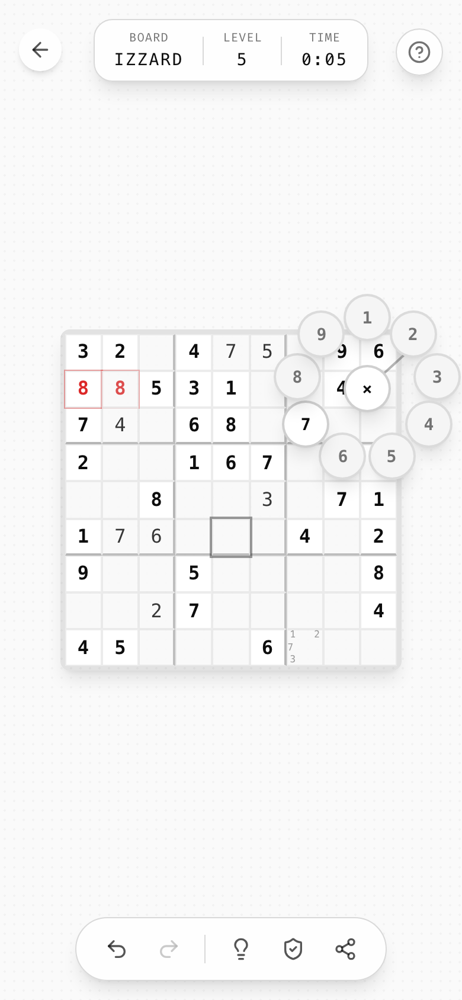
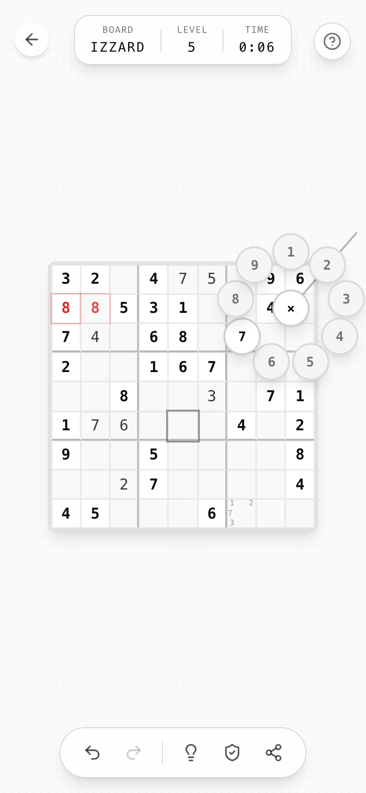
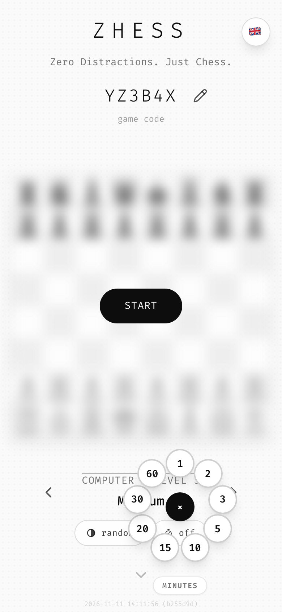

# 08 · Interaction

## Input model

| Platform | Primary | Secondary |
|----------|---------|-----------|
| Touch | Tap to select, **long-press + drag** for the radial dial | Swipe, tap-background |
| Mouse | Click | Hover reveals (delete ×) |
| Keyboard | Digits `1`–`9` place, `Shift`+digit toggles a note, `Backspace`/`Delete`/`0` clears | `Enter` confirms / `Escape` cancels edits |

Read keys by **physical code** (`e.code === "Digit3"`), not `e.key`, so `Shift+1` still means "1" on every keyboard layout.

### Moving things

In games where you move a piece rather than fill a cell, offer all three paths. Zhess:

| Path | How |
|------|-----|
| **Tap-tap** | Tap a piece, then a target. Tapping another own piece changes the selection; tapping anywhere else clears it. |
| **Drag** | The piece follows the pointer, lifted above the finger so it stays visible. On touch the drop target is the cell **under the finger**, not under the lifted piece, and a ring marks it. An illegal drop snaps back without comment. |
| **Keyboard** | Arrow keys move a focus ring (roving `tabindex`), `Enter`/`Space` pick up and drop, `Escape` clears. Zhess also accepts typed notation (`Nf3`, `O-O`) plus `Enter`, shown in a small chip under the board. |

Legal targets are shown while a piece is selected (dots on empty cells, rings on captures), as part of the helpers bundle ([feedback](09-feedback.md#helpers-safety-mode)).

## The long-press ladder

Long-press is the izzardry "secondary action". Durations are tiered by how deliberate the action should be:

| Hold | Action | Release behavior |
|------|--------|------------------|
| **300 ms** | Open the radial dial on a cell | Release commits the selection |
| **500 ms** | Open the options popover on the "new code" button (search for a hard seed) | Short press = normal action |
| **1000 ms** | **Peek**: reveal the whole solution | Reveal lasts only while held; release hides it |
| **3000 ms** | Easter egg (donation prompt) on the help button | |

Zhess maps its holds onto the same tiers, which shows the ladder carries over to other games:

| Hold | Zhess |
|------|-------|
| 300 ms | Promotion dial on the target square |
| 500 ms | Custom time on the clock pill · resign on the flag (tap offers a draw) · jump to start/end on the review steppers |
| 1000 ms | Threat peek on the hint bulb, while held |
| 3000 ms | Easter egg on the help button |

Rules:
- A long press must **suppress the click** that follows release (`isLongPress` ref, reset 50 ms later).
- Cancel on `mouseleave` / `touchcancel`.
- Every long-press feature is announced in the button's `aria-label`: `"Get hint (hold for full reveal)"`, `"Generate new seed (hold for options)"`. The easter egg too: Zhess labels help `"Show help (hold for a surprise)"`.
- Suppress the context menu on hold targets, so a long touch never opens the iOS callout.

### Keyboard twin for a long press

Every hold needs a key. Zhess uses two:

- **Holding `Space`** for the same time works on any hold button. Buttons activate on `Space` key-up, so a held key can count as a long press, while `Enter`, which clicks on key-down, stays a tap.
- **A modifier opens the hold action at once.** On the clock pill `Shift+Enter`, `Shift+F10` or the `ContextMenu` key open the custom dial; on a board square `Shift+Enter` or `Shift+Space` opens the promotion dial, and the arrow keys aim in it.

## Radial dial (signature)

A thumb-sized pie menu for choosing from ≤ 9 values without covering the board with a keypad.

| Spec | Value |
|------|-------|
| Trigger | 300 ms touch hold on an editable cell |
| Position | At the finger, clamped so the dial (60 px radius + 20 px item) stays 80 px inside the viewport |
| Items | 40 px circles (`w-10 h-10 rounded-full bg-card border-2 border-foreground/20 shadow-lg font-mono font-semibold text-sm`), on a 60 px radius, item 1 at 12 o'clock going clockwise |
| Center | `×` = clear. Selected when the finger is < 25 px from the start point. |
| Aim zone | 40–55 px from start: the item under the angle is **aimed** → `bg-accent scale-[1.6] ring-2 ring-foreground/30`. Releasing here = **secondary action** (toggle note). |
| Commit zone | ≥ 55 px: the item pops out to a 105 px radius and inverts (`bg-foreground text-background`, `scale-[1.6]`). Releasing here = **primary action** (place digit). |
| Disabled | Impossible values are `text-muted-foreground bg-muted` and **skipped**: aiming at them selects nothing. |
| Current state | Values already noted get `ring-2 ring-foreground/40`. |
| Rubber band | An SVG line from the dial center to the finger, `stroke currentColor`, 2 px, 30 % opacity, round caps. |
| Render | Portaled to `body` (escapes the board's filter stacking context). |

The two-distance idea (aim = soft action, push through = hard action) is reusable for any game with a primary and a secondary action per target.

Zhess reuses the dial twice, which settles how it generalizes:

- **No secondary action, no aim zone.** In the promotion dial (Q, R, B, N), releasing in the aim zone commits too, and the center or the dead ring cancels.
- **Up to 9 items per ring.** That is what fits a 60 px radius. Zhess's clock dial picks minutes (1, 2, 3, 5, 10, 15, 20, 30, 60) and then the increment in the same dial, with a small caption chip (`MINUTES`) naming the current step. Values that don't fit are left out (no 45 or 90).
- **Clamp the whole thing.** The clamp reserves the popped-out item, the caption and the bottom safe area, and the caption moves above the ring when the dial was pushed up.
- **Off the board, too.** A dial can open from a pill (the clock pill on the start screen), not only from a cell.

## Tap background to hide UI

In game, tapping empty stage space (`e.target === e.currentTarget`) toggles all chrome. Tapping again brings it back. The tutorial teaches it ("Tap background to hide UI").

One tap does one thing: if something is pending (Zhess: a queued premove), the first tap on the background cancels it and leaves the chrome alone.

## Swipe to delete (touch) / hover × (mouse)

- **Direction lock:** after 8 px of movement, the larger axis wins. A vertical lock lets the page scroll; a horizontal lock calls `preventDefault`.
- **Left only.** A rightward drag resets.
- **Threshold:** 40 % of card width.
- **Desktop:** an `X` in a 24 px round button (`absolute top-2 right-2 bg-card border shadow-sm`) appears on card hover (`opacity/scale-90 → 100`, 150 ms) and turns red on its own hover.
- Both paths end in the same collapse animation and an **undo toast** (see [feedback](09-feedback.md)).

## Selectors

- **Stepper:** `‹ value ›` with chevron icon-buttons. Ends disable at `opacity-30`. Use it for ordered values (level 1–12). One stepper can span modes: Zhess's opponent stepper runs `ROOM · TWO PLAYERS · COMPUTER 1 BEGINNER … COMPUTER 12 INSANE`, so choosing a mode and a level is one control ([components](10-components.md#opponent-stepper)).
- **Option pill:** a `.pill-sm` that cycles a short list on tap (Zhess color: random → white → black; clock: off → 1+0 → … → 30+0). A hold opens the radial dial for a custom value. The choice is remembered. When it doesn't apply, the pill stays in place, dimmed and disabled.
- **Code field:** big tappable code. Tap = new random code, ✎ = edit inline (an underlined input with max length and allowed-character filter), ✓ / `Enter` / blur = confirm, `Escape` = revert.
- **Dropdown:** only for unordered sets (language).

## Feedback to touch

- Every pressable element has `active:scale-95`.
- Text selection is disabled on game surfaces (`select-none`). Long-press must never select text or open the iOS callout.
- Pinch-zoom is disabled (`maximum-scale=1, user-scalable=no`). The layout must therefore be legible without zoom.

## Scrolling

- The start screen scrolls (history below the fold). The game screen never does.
- A bouncing `ChevronDown` (`animate-bounce text-muted-foreground/50`) under the start footer hints that there's more. Clicking it smooth-scrolls one viewport.
- After 50 px of scroll, the start header is swapped for a sticky wordmark header, and a back-to-top FAB appears.
- Review screens step with the same keys and gestures everywhere: undo/redo buttons, `←`/`→`, `Home`/`End`, and a horizontal swipe on the board (Zhess).
