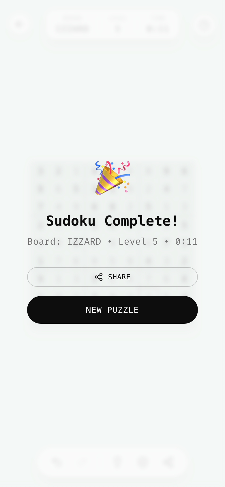
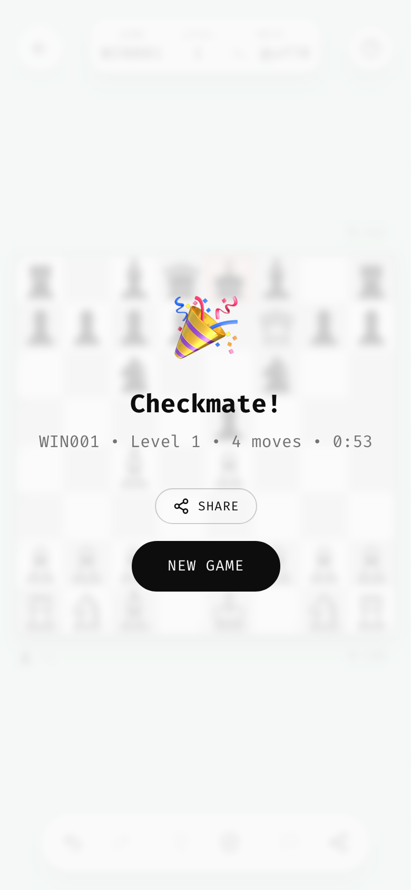

# 09 · Feedback & states

## Board cell states

Board cells are the most state-dense element. The recipe below generalizes to any grid game (tiles, cards, slots). States combine in this priority, lowest to highest:

| State | Visual | z |
|-------|--------|---|
| Base | `bg-card border border-border/50` | |
| Group complete | `bg-success/5` | |
| Given / fixed | `font-bold` | |
| Player value | `font-normal`, digit at `foreground/80` (dim the ink, not the cell) | 30 |
| Related (same row/col/box as selection) | `foreground/5` overlay | |
| Selected | `foreground/10` overlay + `ring-2 ring-foreground/50` | 40 |
| Conflict | `text-destructive font-semibold bg-destructive/15 ring-1 ring-destructive/40` + synced error pulse | 20 |
| Just hinted | `animate-hint-pulse` (green, 800 ms, once) | |

**Implementation note.** State fills are *overlays on the cell's card color*, not replacements. In plain CSS that's `background-image: linear-gradient(<tint>, <tint>)`; in Tailwind, make sure the state class wins over the base `bg-card` (put both in the same layer, or apply `bg-card` only when no state is active). In Zudoku the state classes sit in `@layer components` while `bg-card` is a utility, so the related, selected and conflict fills never render (see the [audit](90-zudoku-audit.md)).

Pencil marks (notes): `absolute text-[0.5rem] leading-none text-foreground/50`. They fill the **4 corners first, then the 4 edge midpoints** (max 8). A note that conflicts with a placed value is hidden automatically.

### Two-tone boards

On a checkerboard every gray fill competes with the two square tones. Keep the light squares lighter in both themes ([color](03-color.md#two-tone-patterns)) and use **half the step (`foreground/5`)** for every gray state fill. Zhess's square states, lowest first:

| State | Visual | Helpers |
|-------|--------|---------|
| Last move (from and to) | `foreground/5` overlay | yes |
| Selected piece | `foreground/5` overlay + `ring-2 ring-inset ring-foreground/50` | no |
| Legal target, empty | centered dot, 28 % of the square, `foreground/25` | yes |
| Legal target, capture | inscribed ring, `foreground/25` | yes |
| Queued move (premove) | dashed outline, `foreground/40` | no |
| King in check | `destructive/15` overlay + `ring-1 ring-destructive/40`, synced pulse | yes |
| Mistake bounced back | the piece pulses `destructive` once | yes |
| Hint | `hint-pulse` (green, 800 ms, once), above the neighbours | n/a |
| Threat peek | `destructive/10` overlay on attacked squares, while held | n/a |

Selection is a fill **and** a ring, so it survives the half-step fill. Markers are distinct shapes (dot, ring, dashed outline), so no two states rely on gray level alone.

## Helpers ("safety mode")

A single toggle (`ShieldCheck`/`ShieldOff`, persisted, **on by default**) controls all assistive feedback:

- conflict highlighting,
- disabling impossible values in the dial,
- auto-hiding conflicting notes,
- strict group-complete detection.

Off = purist mode: the icon dims to `text-muted-foreground/40`. Each new game should bundle its "helpful but spoiler-ish" features under this one toggle, not under several settings.

Zhess bundles legal-move dots and capture rings, the last-move highlight, the check glow, the board coordinates and the blunder guard. Off is a bare board.

### Guard, don't ask

When a helper can tell that a move is a likely mistake, **bounce it back once instead of asking**. Zhess's blunder guard (against the computer, helpers on) checks each move in the engine worker within about 150 ms. A move that loses 3 pawns or more, or allows a mate in two, is not played: the piece returns to its square and pulses red once. Playing the same move again within 5 s commits it. There is no dialog and no text. If the check is late, the move goes through.

## Hints

- **Tap:** reveal one correct cell (prefer the selected cell), select it, play the green hint pulse. It goes through undo history like any move.
- **Hold 1 s:** peek at the full solution while held.
- Hints are unlimited and not shamed (no counter, no score penalty).
- Zhess shows *where* to look before *what* to do: the first tap pulses the piece the engine would move, the second its target. The hint never plays the move. Holding the bulb shades every square the opponent attacks while held.
- If you record assistance, record it quietly. Zhess marks a game with a hint or an undo as assisted: a small hollow dot in history, with no other consequence.

## End of game



1. When the board is full, the **page background tints over 1000 ms**: `success/12` if it's correct, `destructive/12` if it's full but wrong. A wrong board gets no modal; the tint *is* the message.
2. If correct: the timer stops and a **completion overlay** appears (`bg-background/80 backdrop-blur-sm animate-fade-in`, content `animate-scale-in`):
   - `🎉` at `text-6xl mb-6`
   - Title `text-2xl font-mono font-bold`: "Sudoku Complete!"
   - Summary `text-muted-foreground`: `Board: IZZARD • Level 5 • 0:09` (bullet `•` separators)
   - Actions: ghost **Share** + primary **New Puzzle** (stacked on mobile, row ≥ 640 px)
   - Tapping the scrim dismisses (to admire the board).
3. Shown once per game. 1.5 s later, the one-time donation prompt may follow (see [monetization](13-monetization.md)).

**Against an opponent** (Zhess) the same sequence runs for every ending, seen from the device's player:

| Outcome | Tint | Glyph | Title |
|---------|------|-------|-------|
| Win | `success/12` | 🎉 | `Checkmate!` / `You won!` |
| Loss | `destructive/12` | none | `Checkmate` / `Out of time` / `Resigned` |
| Draw | none | none | `Draw`, plus a reason line (`Stalemate`, `Threefold repetition`…) |
| Two players, one device | none | 🎉 | `White wins!` / `Black wins!` / `Draw` |

- Summary: `K7QW2M • Level 5 • 34 moves • 12:08`. Parts wrap whole, never mid-part.
- Actions: ghost **Share**, primary **New game**, or **Rematch** when the opponent is a person in a room.
- The tint and overlay mark the moment a game ends **in this session**. Opening a finished game from history goes straight to review, without them.
- If the ending can be undone (a resignation with its 5 s undo toast), the overlay waits until the toast is gone.



## Toasts

Two kinds:

**System toasts** (sonner): one line, e.g. `toast.success("Link copied!")`. Styled `bg-background text-foreground border-border shadow-lg`. Use them for confirmations of invisible actions (copy, update ready). The only icon is the small check that sonner adds to `toast.success`, in the toast's text colour (never `richColors`); add no others.

**Undo toasts** (custom, for destructive actions):

```
┌──────────────────────────────────────┐
│ M00NLT removed           [UNDO]  ×   │   rounded-xl bg-card border shadow-lg px-4 py-3
└──────────────────────────────────────┘
          [ UNDO ALL ]                     appears when ≥ 2 are stacked
```

- Bottom-center, `w-[min(90vw,360px)]`, stacked with `gap-2`.
- Subject in mono + tracking (`M00NLT`), verb in `muted-foreground` (`removed`).
- `Undo` is a small inverted button (`bg-foreground text-background rounded-md px-3 py-1 text-xs uppercase tracking-wider`).
- **5 s** lifetime; every new deletion restarts the timer for the whole stack.
- The deletion happens immediately; undo restores. Never ask "Are you sure?".
- The same toast undoes any other destructive action. Zhess resigns at once and offers **Undo** for 5 s against the computer or a second player on the same device. In a room the opponent has already been told, so it is final there.

### Where toasts go

In game, toasts sit above the toolbar and never cover the board or the chrome ([layout](05-layout.md#content-width)). On the start screen, the bottom center is free.

### Requests from another person

When a second person can ask for something (takeback, draw, rematch, letting a new device in), Zhess uses one quiet pattern:

- **Incoming:** an undo-style toast with the request and two actions, `Decline` and `Accept` (`Allow` for a device). It stays until answered and disappears by itself when the request lapses (the requester moved, the game changed, the peer left).
- **Outgoing:** no toast. The button that asked pulses (`animate-pulse`) until the answer arrives. A toast would sit on the toolbar for as long as the request is open.
- **One outgoing request at a time.** Crossing draw offers or rematch requests count as agreement.

### Status that changes often

Presence and connection messages (`Opponent connected`, `Opponent disconnected`, `Reconnected`) share **one toast slot**, so a quick flap shows only the latest. A failure message (`Could not reach your opponent directly. Try another network.`) appears **once per cause**, with the one action that can help.

> **sonner gotcha.** sonner 1.7 keeps a dismissed toast's id marked for deletion through its ~200 ms exit. A toast re-created under the same id in that window vanishes at once. Hand out a fresh id per showing and keep it while the toast is on screen (Zhess: `toastSlot.ts`).

## Update available

A toast with title "A new version is available" and a **Reload** action, kept for 15 s.

Never reload by yourself in the middle of a game. With `registerType: "autoUpdate"` the new worker takes control on its own; Zhess then reloads only when no game is in progress, and otherwise shows the same Reload toast.

## Loading & long work

- Replace the triggering icon with `Loader2 animate-spin` in the same spot. Don't add a separate spinner.
- Dim the dependent content (`opacity-50 cursor-wait`) instead of hiding it.
- A tooltip on the spinner shows real progress (`font-mono text-xs whitespace-pre-line`): phase, `current / total (percent%)`, or for searches: tried, current, best so far, worker count, and "Click to cancel".
- Clicking the spinner cancels and **restores the previous state**.
- The preview board shows an empty grid while generating. No skeleton shimmer.
- If the primary action has to wait (Zhess: Start before the engine has loaded), the **Start pill** itself shows the spinner and the percentage, and a tap cancels the wait. The download continues in the background.
- A large download that the player didn't ask for gets a **status line**, not a spinner: one faint line on the start screen with the percentage and a thin bar, then a quiet `ready offline` ([platform](12-platform-pwa.md#large-assets)).
- A failure gets one calm toast with **Try again**, under a fixed id so it never stacks.

## Disabled

`opacity-30 cursor-not-allowed` on icon buttons (undo at history start, stepper ends). Keep disabled controls in place, so the layout doesn't shift. Zhess disables the hint bulb while the computer is thinking, and dims the color pill in pass-and-play.

A control that doesn't apply in a **mode** is hidden, not disabled; see [toolbar slots](10-components.md#slots-per-mode).

## Empty states

If there's nothing to show, show nothing. The history section simply doesn't render, and the scroll chevron disappears with it. No "No games yet" illustrations.
