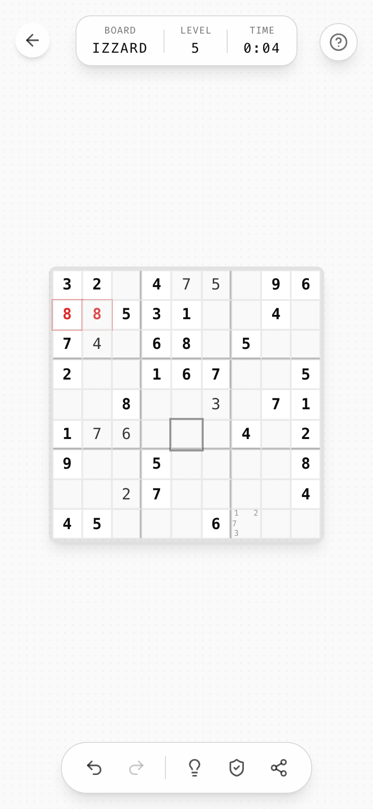
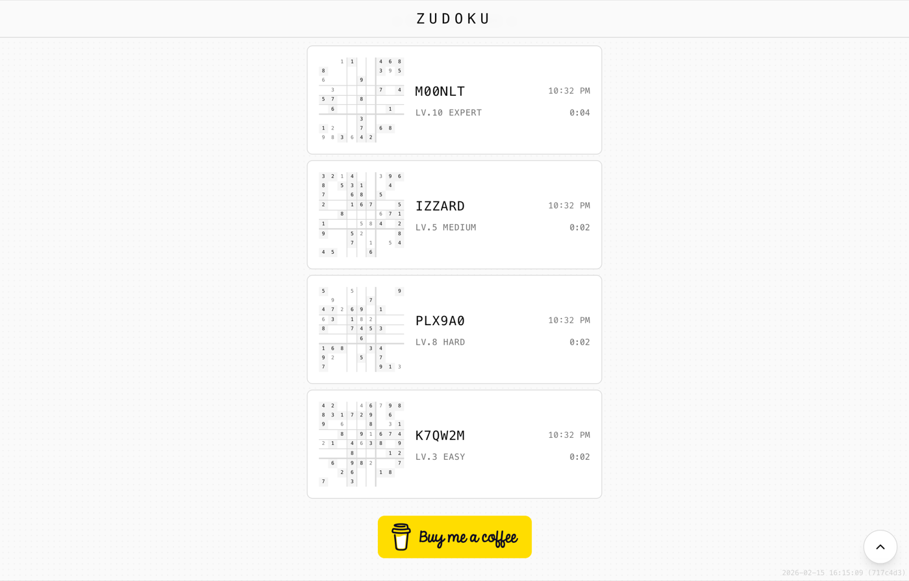

# 10 · Components

Every reusable piece, with its recipe. Class names refer to [`tokens/ztyle.css`](../tokens/ztyle.css) (plain CSS) or Tailwind utilities.

## Buttons

There are three kinds and one exception. Don't add more.

### Primary: `.btn-primary`

```
px-8 py-3 rounded-full bg-foreground text-background border-2 border-foreground
font-mono uppercase tracking-wider text-sm
transition-all duration-200 hover:opacity-90 active:scale-95
```

There is one per screen, at most: **Start**, **New Puzzle**. On the start screen it sits in the exact center of the blurred board.

### Ghost: `.btn-ghost`

```
px-4 py-2 rounded-full bg-transparent text-foreground border border-foreground/20
font-mono uppercase tracking-wider text-xs
transition-all duration-200 hover:bg-foreground/5 active:scale-95
```

Secondary actions next to a primary (**Share**). Can hold a leading `w-4 h-4` icon with `gap-2`.

### Icon: `.icon-button`

```
p-2 rounded-full text-foreground/70 hover:text-foreground hover:bg-foreground/10
transition-all duration-150 active:scale-95
```

A 20 px lucide icon, so 36 px total. It always has an `aria-label`. Disabled = `opacity-30 cursor-not-allowed`.

### Floating round button: `.fab`

```
w-10 h-10 rounded-full bg-card/80 backdrop-blur-sm border border-border shadow-lg
flex items-center justify-center text-muted-foreground hover:text-foreground
```

Standalone chrome at screen corners: help, language (flag emoji `text-lg`), back (back uses `.icon-button` + `bg-card/80 backdrop-blur-sm shadow-md`). Back-to-top is the large variant: `w-12 h-12`, `bg-card/90`.

### Exception: small pill

`px-3 py-1.5 rounded-full border border-border bg-card/80 backdrop-blur-sm text-xs tracking-wide text-muted-foreground hover:text-foreground hover:bg-muted` with a `w-3 h-3` icon. Used for low-priority persistent offers (**Install App**).

## Toolbar: `.chrome-bar`



```
fixed bottom-[max(1rem,safe)] left-1/2 -translate-x-1/2 z-40
flex items-center gap-2 px-4 py-2 rounded-full
bg-card/80 backdrop-blur-sm border border-border shadow-lg
```

- Content: icon-buttons, grouped by meaning with a short divider (`w-px h-6 bg-border mx-1`).
- Order: **history** (undo, redo) │ **assist** (hint, helpers) **out** (share). The most-used action is leftmost.
- ≤ 6 buttons. Landscape: the same bar, vertical (`flex-col px-2 py-4`), right-center.

## Stats pill

```
inline-flex items-center gap-4 px-4 py-2 rounded-2xl bg-card/80 backdrop-blur-sm border border-border shadow-lg
  └ stat: eyebrow (text-[10px] uppercase tracking-wider text-muted-foreground)
          value   (font-mono text-sm tracking-widest)
  └ divider: h-6 w-px bg-border
```

Exactly the identity of the current game: **code, level, time**. Each game shows its own ≤ 3 stats, always as eyebrow over value.

## Code selector

```
[↻]   I Z Z A R D   [✎]
        board code          ← text-xs text-muted-foreground/70, lowercase
```

- Code: `.code-display` (`font-mono text-2xl sm:text-3xl md:text-4xl font-light tracking-widest`), and it's a button that rolls a new code.
- Edit mode: same type in an `<input>` with `bg-transparent border-b-2 border-foreground/30 focus:border-foreground text-center outline-none w-48`, `maxLength=8`, uppercase-coerced, `[^0-9A-Z]` stripped.

## Stepper (level selector)

```
‹   LEVEL 5 / 10   ›
       Medium
```

- Label: `.overline` (`text-sm uppercase tracking-wider text-muted-foreground`), with an optional `/ max` in `text-muted-foreground/50`.
- Value: `text-lg font-mono font-medium`, `min-w-[120px]` so the chevrons never jump.
- Chevrons: icon-buttons with `w-6 h-6` icons.

## Board frame

```
grid grid-cols-N p-1 bg-foreground/10 rounded-lg shadow-lg w-fit
```

Cells: see [feedback › cell states](09-feedback.md#board-cell-states). Group boundaries: `border-r-2 / border-b-2 border-foreground/30` on the last cell of each group.

## Board thumbnail

A static, non-interactive miniature of a saved game (54 px default, 120 px in the history list): `bg-border rounded-sm`, cells `bg-card` (givens `bg-muted`), 0.5 px gaps, 1.5 px between groups, digits `font-mono` at 55 % of the cell size (player values at 60 % opacity). Every game should have a thumbnail renderer for its history list.

## List card (history item)



```
.list-card = p-4 rounded-lg border border-border bg-card transition-all duration-200
             hover:border-foreground/30 hover:shadow-sm cursor-pointer
┌───────────────────────────────────────────────┐
│ [thumb]  M00NLT                     10:31 PM  │  ← font-mono text-lg tracking-wider / text-xs muted
│          LV.10 EXPERT          4:12   ✓       │  ← overline text-xs / mono xs muted / success ✓
└───────────────────────────────────────────────┘
```

- Swipe-left (touch) or hover-× (mouse) to delete. See [interaction](08-interaction.md).
- Section heading above a list: `ChevronDown · PREVIOUS GAMES · ChevronDown` (`text-sm uppercase tracking-wider text-muted-foreground`, centered).
- Show the **5 most recent**, then a full-width outline button `"N more games"` (`py-3 text-sm font-mono uppercase tracking-wider border border-border rounded-lg`) that opens the full-screen list.
- Full-screen list: sticky blurred header (`← ALL GAMES`), grouped by **Today / This Week / This Month / This Year / Older** with `text-xs uppercase tracking-wider text-muted-foreground` group labels.
- Time column: time of day if today, else `MMM d`.

## Sticky header

`fixed top-0 inset-x-0 z-30 bg-background/95 backdrop-blur-sm border-b border-border pt-[safe-top]`, centered wordmark at `text-xl`. It slides in from the top (300 ms) once you scroll past 50 px.

## Overlay / celebration

Full-viewport `fixed inset-0 z-50 bg-background/80 backdrop-blur-sm flex items-center justify-center`. Content is centered text with `p-8`. No card, no box. See [feedback › end of game](09-feedback.md#end-of-game).

## Bottom-sheet prompt (install)

`fixed inset-0 flex items-end justify-center p-4 pointer-events-none` → card `pointer-events-auto max-w-sm bg-card border rounded-2xl shadow-xl p-4 animate-slide-up`:
- 48 px icon tile (`bg-primary/10 rounded-xl`, icon `text-primary w-6 h-6`), title `font-mono font-medium tracking-wide text-sm`, description `text-xs text-muted-foreground`, dismiss `X`.
- Two equal buttons: outline "Not now" and filled "Install". **Use pill shapes** (`.btn-ghost` / `.btn-primary` sizing), not `rounded-xl` (Zudoku deviation).

## Dialog

For rare, personal moments only (the donation ask). Use a centered card, `sm:max-w-md`, `text-center`, a 48 px round icon disc on top, `text-xl` title, `text-base` description, one main action and a lowercase whisper-link dismiss (`text-sm text-muted-foreground/60`). The scrim should match overlays (`bg-background/80 backdrop-blur-sm`), not black.

## Tutorial bubble

`bg-card/95 backdrop-blur-sm rounded-xl px-4 py-3 shadow-xl border border-border text-sm max-w-[200px]`. Title `font-medium text-xs`, body `text-muted-foreground text-[10px]`, leading icon `w-3–4 h-3–4 text-primary`. See [onboarding](15-onboarding.md).

## Tooltip & popover

shadcn/Radix defaults with mono content. Popover menus are a column of `px-3 py-2 rounded-md text-sm hover:bg-accent` rows with a label left (`font-medium`) and a description right (`text-xs text-muted-foreground`), headed by a `text-xs text-muted-foreground font-medium` caption.

## Language switcher

A `.fab` showing the current flag emoji. The dropdown (`align="end" min-w-[140px]`) has rows of `flag + native name`, and the current one is bold. It is visible on the start screen only.

## Version stamp

`fixed bottom-right (bottom-center on mobile) font-mono text-[9px] sm:text-[10px] text-muted-foreground/30`, content `YYYY-MM-DD HH:MM:SS (abc1234)`. Tapping it copies the string and checks for an update (`active:text-muted-foreground/60`). Start screen only.

## Text links

Rare. `text-sm text-muted-foreground/60 hover:text-muted-foreground transition-colors`, lowercase copy. No underline.
