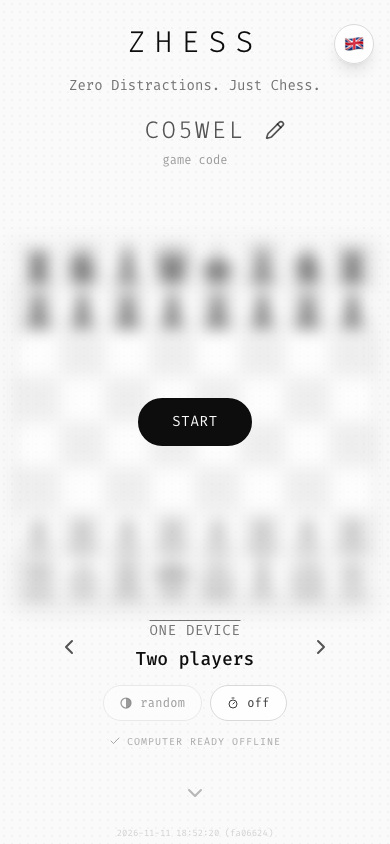
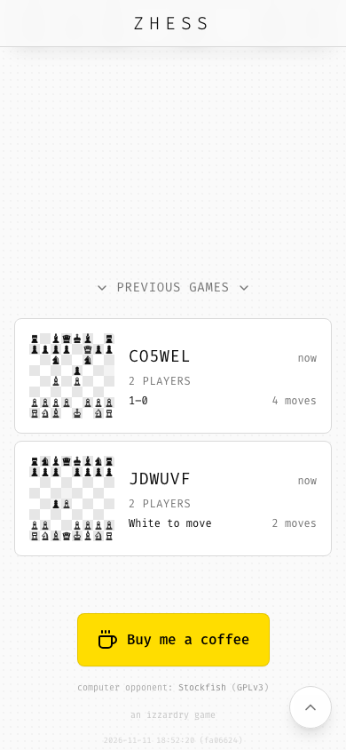
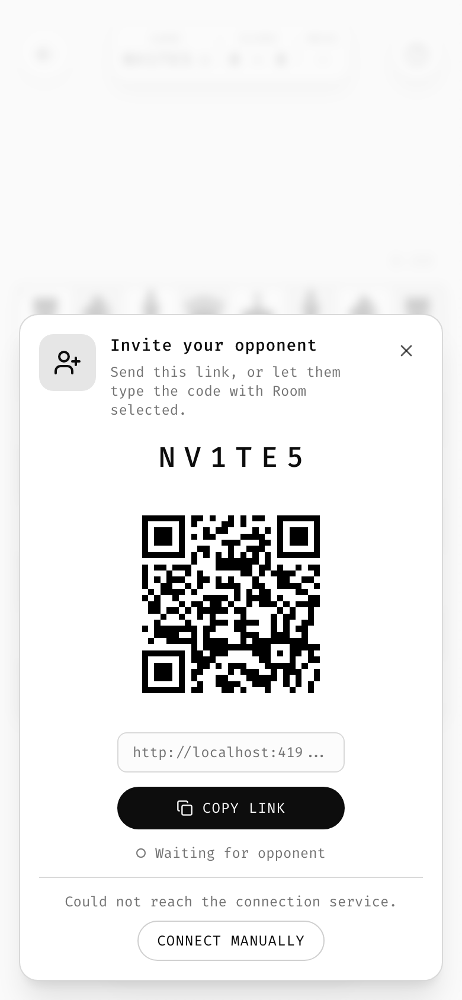

# 10 · Components

Every reusable piece, with its recipe. Class names refer to [`tokens/ztyle.css`](../tokens/ztyle.css) (plain CSS) or Tailwind utilities.

## Buttons

There are three kinds and one exception. Don't add more.

### Primary: `.btn-primary`

```
px-8 py-3 rounded-full bg-foreground text-background border-2 border-foreground
font-mono uppercase tracking-wider text-sm
transition-all duration-200 hover:opacity-90 active:scale-95
```

There is one per screen, at most: **Start**, **New Puzzle**. On the start screen it sits in the exact center of the blurred board.

**The label follows the context, the action stays one.** Zhess's Start pill reads `START` for a new code, `RESUME` for an unfinished game with that code, `REVIEW` for a finished one; the selectors below then show that game's settings, dimmed. When the start has to wait for something, the pill shows `Loader2` and the percentage inside itself, and a tap cancels.

### Ghost: `.btn-ghost`

```
px-4 py-2 rounded-full bg-transparent text-foreground border border-foreground/20
font-mono uppercase tracking-wider text-xs
transition-all duration-200 hover:bg-foreground/5 active:scale-95
```

Secondary actions next to a primary (**Share**). Can hold a leading `w-4 h-4` icon with `gap-2`.

### Icon: `.icon-button`

```
p-2 rounded-full text-foreground/70 hover:text-foreground hover:bg-foreground/10
transition-all duration-150 active:scale-95
```

A 20 px lucide icon, so 36 px total. It always has an `aria-label`. Disabled = `opacity-30 cursor-not-allowed`.

### Floating round button: `.fab`

```
w-10 h-10 rounded-full bg-card/80 backdrop-blur-sm border border-border shadow-lg
flex items-center justify-center text-muted-foreground hover:text-foreground
```

Standalone chrome at screen corners: help, language (flag emoji `text-lg`), back (back uses `.icon-button` + `bg-card/80 backdrop-blur-sm shadow-md`). Back-to-top is the large variant: `w-12 h-12`, `bg-card/90`.

### Exception: small pill

`px-3 py-1.5 rounded-full border border-border bg-card/80 backdrop-blur-sm text-xs tracking-wide text-muted-foreground hover:text-foreground hover:bg-muted` with a `w-3 h-3` icon. Used for low-priority persistent offers (**Install App**).

## Toolbar: `.chrome-bar`


```
fixed bottom-[max(1rem,safe)] left-1/2 -translate-x-1/2 z-40
flex items-center gap-2 px-4 py-2 rounded-full
bg-card/80 backdrop-blur-sm border border-border shadow-lg
```

- Content: icon-buttons, grouped by meaning with a short divider (`w-px h-6 bg-border mx-1`).
- Order: **history** (undo, redo) │ **assist** (hint, helpers) **out** (share). The most-used action is leftmost. A game with an ending to call adds a third group: Zhess uses history │ assist (hint, helpers, seating) │ **end and out** (flag, share).
- Aim for ≤ 6 buttons. The hard limit is what fits a 320 px screen at 44 px each: 7.
- Landscape: the same bar, vertical (`flex-col px-2 py-4`), right-center. If one column doesn't fit below the help button with room for toasts, fold it into **two columns** (Zhess on short phones).
- **Touch targets stay 44 px.** On narrow screens shrink the bar's padding, divider margins and gaps, never the buttons.

### Slots per mode

When a game has several modes, the toolbar is a fixed row of **slots**, and each mode decides what a slot does or hides it. The positions never move, so the hand learns them once. Zhess:

| Slot | Computer | Two players | Room | Review |
|------|----------|-------------|------|--------|
| Undo | one full turn back | one ply back | takeback request | step back (hold: to start) |
| Redo | replay | replay | hidden | step forward (hold: to end) |
| Hint | yes | yes | hidden | hidden |
| Helpers | yes | yes | yes | yes |
| Seating | hidden | face to face ⇄ side by side | hidden | flip the board |
| Flag | tap: offer draw · hold: resign | hold: resign | tap: offer draw · hold: resign | continue from here |
| Share | link | link | invite sheet | link or PGN |

Write the table before building the toolbar. Hide a slot that has no meaning in a mode; disable one that is only unavailable for the moment (redo with nothing to redo). In a room whose game is over, Zhess turns the flag slot into **Rematch**.

## Stats pill

```
inline-flex items-center gap-4 px-4 py-2 rounded-2xl bg-card/80 backdrop-blur-sm border border-border shadow-lg
  └ stat: eyebrow (text-[10px] uppercase tracking-wider text-muted-foreground)
          value   (font-mono text-sm tracking-widest)
  └ divider: h-6 w-px bg-border
```

Exactly the identity of the current game: **code, level, time**. Each game shows its own ≤ 3 stats, always as eyebrow over value.

Zhess's **info pill** has three cells, eyebrow over value: `GAME` `K7QW2M` (with a presence dot in a room), the opponent (`LEVEL` `5`, `PLAYERS` `2`, or `SCORE` `2 – 1½` in a room), and `MOVE` `12. ♘f3 e5`. Per-player values such as clocks move to the [board-edge strips](05-layout.md#board-edge-strips). A stat may be a button: tapping the move strip opens the full move list in a popover. Below 360 px the pill uses two rows rather than dropping a cell.

## Code selector

```
[↻]   I Z Z A R D   [✎]
        board code          ← text-xs text-muted-foreground/70, lowercase
```

- Code: `.code-display` (`font-mono text-2xl sm:text-3xl md:text-4xl font-light tracking-widest`), and it's a button that rolls a new code.
- Edit mode: same type in an `<input>` with `bg-transparent border-b-2 border-foreground/30 focus:border-foreground text-center outline-none w-48`, `maxLength=8`, uppercase-coerced, `[^0-9A-Z]` stripped.

## Stepper (level selector)

```
‹   LEVEL 5 / 10   ›
       Medium
```

- Label: `.overline` (`text-sm uppercase tracking-wider text-muted-foreground`), with an optional `/ max` in `text-muted-foreground/50`.
- Value: `text-lg font-mono font-medium`, `min-w-[120px]` so the chevrons never jump.
- Chevrons: icon-buttons with `w-6 h-6` icons.

## Opponent stepper

A stepper whose ordered values span the modes, so a game with several ways to play keeps a single selector on the start screen. Zhess:

```
‹   COMPUTER · LEVEL 5   ›          ‹   ONE DEVICE   ›          ‹   TWO DEVICES   ›
          Medium                          Two players                     Room
```

- Values: `ROOM` · `TWO PLAYERS` · `COMPUTER 1 BEGINNER` … `COMPUTER 12 INSANE`. The last choice is remembered; the first-run default is computer level 5.
- Overline = what kind of opponent, value = which one. `min-w-[180px]`.
- `←`/`→` step while focus is inside.

## Option pills

Small settings that apply to the next game sit under the stepper as a row of `.pill-sm` buttons with a 12 px glyph and a lowercase value: Zhess's `◐ random` and `⏱ off`. Tap cycles, a hold may open the [radial dial](08-interaction.md#radial-dial-signature) for a custom value (the clock pill), the choice is remembered, and a pill that doesn't apply is dimmed and disabled in place (`min-h-9 px-4`).

## Status line

One faint line under the pills for a background state the player should know about but not act on. `h-6 text-[10px] uppercase tracking-widest text-muted-foreground`, a `w-3 h-3` icon, centered. Zhess uses it for the offline copy of its computer opponent:

| State | Line |
|-------|------|
| Downloading | `COMPUTER 43%` and a thin bar (`h-0.5 w-12 bg-foreground/15`, fill `bg-foreground/60`), `role="progressbar"` |
| Ready | `✓ COMPUTER READY OFFLINE` at `muted-foreground/60` |
| Offline, not cached | `WifiOff` · `COMPUTER NEEDS A CONNECTION` |
| Failed / Save-Data | a text button: `↻ DOWNLOAD FAILED · RETRY` / `↓ DOWNLOAD THE COMPUTER` |
| Checking, unsupported | nothing |



## Board frame

```
grid grid-cols-N p-1 bg-foreground/10 rounded-lg shadow-lg w-fit
```

Cells: see [feedback › cell states](09-feedback.md#board-cell-states). Group boundaries: `border-r-2 / border-b-2 border-foreground/30` on the last cell of each group.

## Board thumbnail

A static, non-interactive miniature of a saved game (54 px default, 120 px in the history list): `bg-border rounded-sm`, cells `bg-card` (givens `bg-muted`), 0.5 px gaps, 1.5 px between groups, digits `font-mono` at 55 % of the cell size (player values at 60 % opacity). Every game should have a thumbnail renderer for its history list. Zhess draws its thumbnails from the board's own piece set at **96 px**, so a card still fits a 320 px phone.

## List card (history item)


```
.list-card = p-4 rounded-lg border border-border bg-card transition-all duration-200
             hover:border-foreground/30 hover:shadow-sm cursor-pointer
┌───────────────────────────────────────────────┐
│ [thumb]  M00NLT                     10:31 PM  │  ← font-mono text-lg tracking-wider / text-xs muted
│          LV.10 EXPERT          4:12   ✓       │  ← overline text-xs / mono xs muted / success ✓
└───────────────────────────────────────────────┘
```

- Swipe-left (touch) or hover-× (mouse) to delete. See [interaction](08-interaction.md).
- Section heading above a list: `ChevronDown · PREVIOUS GAMES · ChevronDown` (`text-sm uppercase tracking-wider text-muted-foreground`, centered).
- Show the **5 most recent**, then a full-width outline button `"N more games"` (`py-3 text-sm font-mono uppercase tracking-wider border border-border rounded-lg`) that opens the full-screen list.
- Full-screen list: sticky blurred header (`← ALL GAMES`), grouped by **Today / This Week / This Month / This Year / Older** with `text-xs uppercase tracking-wider text-muted-foreground` group labels.
- Time column: time of day if today, else `MMM d`.
- The second line says what the player needs to decide whether to open it. Zhess: the opponent (`2 PLAYERS`, `LEVEL 5`), and the state (`Your move`, `Their move`, `White to move`, or the result: `Won` in `success`, `Lost` muted, `1–0`, `Draw`), plus the move count and an assisted dot.



## Sticky header

`fixed top-0 inset-x-0 z-30 bg-background/95 backdrop-blur-sm border-b border-border pt-[safe-top]`, centered wordmark at `text-xl`. It slides in from the top (300 ms) once you scroll past 50 px.

## Overlay / celebration

Full-viewport `fixed inset-0 z-50 bg-background/80 backdrop-blur-sm flex items-center justify-center`. Content is centered text with `p-8`. No card, no box. See [feedback › end of game](09-feedback.md#end-of-game).

## Bottom-sheet prompt (install)

`fixed inset-0 flex items-end justify-center p-4 pointer-events-none` → card `pointer-events-auto max-w-sm bg-card border rounded-2xl shadow-xl p-4 animate-slide-up`:
- 48 px icon tile (`bg-primary/10 rounded-xl`, icon `text-primary w-6 h-6`), title `font-mono font-medium tracking-wide text-sm`, description `text-xs text-muted-foreground`, dismiss `X`.
- Two equal buttons: outline "Not now" and filled "Install". **Use pill shapes** (`.btn-ghost` / `.btn-primary` sizing), not `rounded-xl` (Zudoku deviation).

The same sheet carries any short task that needs more than a toast. Zhess's **invite sheet** shows the code in `.code-display`, a QR code, the link in a read-only field, a primary `Copy link` (and `Share` where `navigator.share` exists) and the presence line; a ghost `Connect manually` appears below a divider when the connection service fails. Build it on a Radix dialog (focus trap, `Escape`, scrim tap), with `max-h-[calc(100dvh-2rem)] overflow-y-auto` so it scrolls on short screens.



## Dialog

For rare, personal moments only (the donation ask). Use a centered card, `sm:max-w-md`, `text-center`, a 48 px round icon disc on top, `text-xl` title, `text-base` description, one main action and a lowercase whisper-link dismiss (`text-sm text-muted-foreground/60`). The scrim should match overlays (`bg-background/80 backdrop-blur-sm`), not black.

## Tutorial bubble

`bg-card/95 backdrop-blur-sm rounded-xl px-4 py-3 shadow-xl border border-border text-sm max-w-[200px]`. Title `font-medium text-xs`, body `text-muted-foreground text-[10px]`, leading icon `w-3–4 h-3–4 text-primary`. See [onboarding](15-onboarding.md).

## Tooltip & popover

shadcn/Radix defaults with mono content. Popover menus are a column of `px-3 py-2 rounded-md text-sm hover:bg-accent` rows with a label left (`font-medium`) and a description right (`text-xs text-muted-foreground`), headed by a `text-xs text-muted-foreground font-medium` caption.

## Language switcher

A `.fab` showing the current flag emoji. The dropdown (`align="end" min-w-[140px]`) has rows of `flag + native name`, and the current one is bold. It is visible on the start screen only.

## Presence dot

An 8 px dot next to the thing whose presence it shows (Zhess: the game code in the info pill). Solid `bg-success` = connected; hollow (`border-[1.5px] border-muted-foreground`) and pulsing = waiting or reconnecting. It has a text label (`role="img"`, `aria-label`) and, if tapping it can help, it is a button (Zhess: reopens the invite sheet).

## Banner over the stage

For a state that lasts and blocks play (`This room is open in another tab`, `Waiting for opponent`), show one calm card centered over the stage, with at most one action (`Use here`, `Reload`). Show it only after about 1 s, so a state that resolves at once never flashes.

## Credits line

Third-party assets that need attribution get one line at the bottom of the start screen's scroll area, above `an izzardry game`: `text-[10px] text-muted-foreground/60`, lowercase label, links in `muted-foreground/80`. Zhess: `computer opponent: Stockfish (GPLv3)`, linking to the upstream source and to the licence file shipped next to the engine.

## Version stamp

`fixed bottom-right (bottom-center on mobile) font-mono text-[9px] sm:text-[10px] text-muted-foreground/30`, content `YYYY-MM-DD HH:MM:SS (abc1234)`. Tapping it copies the string and checks for an update (`active:text-muted-foreground/60`). Start screen only.

## Text links

Rare. `text-sm text-muted-foreground/60 hover:text-muted-foreground transition-colors`, lowercase copy. No underline.
