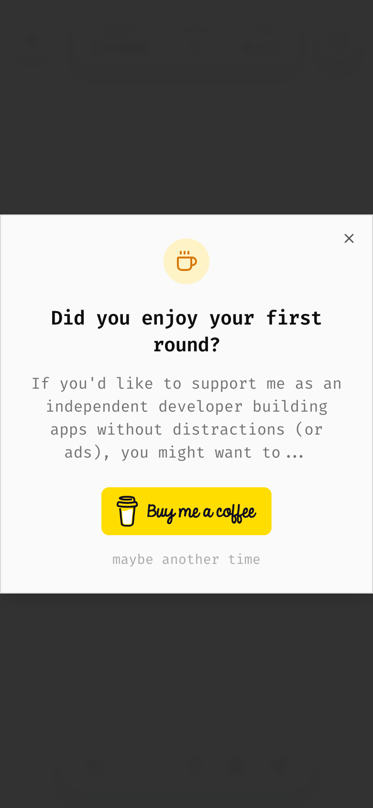

# 13 · Monetization

izzardry games are **free, ad-free, account-free**. Revenue is voluntary support, asked for gently.

## Hard rules

- No ads. Ever. "zero ads" is in the OG description on purpose.
- No paywalls, no premium tier, no "remove ads" upsell.
- No analytics or tracking scripts.
- No dark patterns: no countdowns, no guilt copy, no "No, I don't like supporting developers".

## The donation prompt

| Aspect | Rule |
|--------|------|
| When | **After the first completed game**, 1.5 s after the celebration overlay appears |
| How often | **Once per device, ever** (`<game>:donation-shown`) |
| Where | Centered dialog, `sm:max-w-md`, `text-center` |
| Icon | `Coffee` in a 48 px round amber disc (the only place amber is used) |
| Title | "Did you enjoy your first round?" |
| Body | "If you'd like to support me as an independent developer building apps without distractions (or ads), you might want to..." Personal "me", ends trailing off into the button. |
| Action | The official Buy Me a Coffee button image (yellow, 50 px tall) |
| Dismiss | Whisper link, lowercase: "maybe another time" |

Use the same copy (translated) in every game, so the voice stays consistent across the catalogue.

## Persistent support link

At the very bottom of the start screen's scroll area (below history), the Buy Me a Coffee button (60 × 217 px) is always there. On mobile it fades in only after the player scrolls into history, so it never competes with the start screen.

## Easter egg

Long-pressing the in-game **help** button for 3 s opens the donation dialog (if it hasn't been shown yet). Keep one small, discoverable delight like this per game.

## Link

`https://www.buymeacoffee.com/<handle>` with `target="_blank" rel="noopener noreferrer"`.
