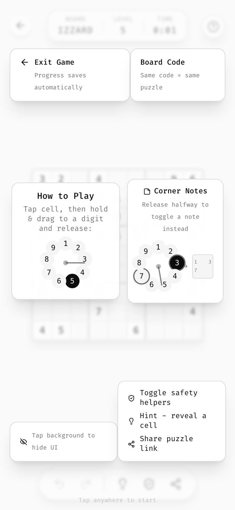

# 15 · Onboarding

## Coach-mark overlay

There is no multi-step walkthrough. There is a **single overlay of floating bubbles placed next to the things they explain**, over the live game.

| Aspect | Rule |
|--------|------|
| When | Automatically the **first time a game starts** (after the start transition). Again any time via the `?` help button. Only for a brand-new game started with the Start pill, never for a resumed one (Zhess). |
| Dismiss | Tap/click **anywhere**. A pulsing `Tap anywhere to start` (`text-[10px] text-muted-foreground/60 animate-pulse`) sits at bottom-center. |
| Scrim | `bg-background/60 backdrop-blur-[2px]`, so the game is visible but soft |
| Layer | Portaled, `z-[100]` |
| Bubbles | See [components › tutorial bubble](10-components.md#tutorial-bubble). They enter staggered (100 ms steps), and all fade out together (400 ms). |
| Placement | Mirrors the real layout: top bubbles near top chrome, bottom bubbles near the toolbar, the "how to play" bubble over the board. A separate arrangement for landscape (3 columns). |
| Device-aware | Touch devices get the gesture explanation plus illustration; pointer devices get "Click a cell, type 1-9" plus a mini keypad plus "Shift+number for notes". |
| Persistence | `<game>:tutorial-seen = true` on dismiss |

## What to cover (template)

1. **Exit**: where it is, and that progress is saved.
2. **Code**: what the board code means.
3. **How to play**: the core input, with a tiny illustration built from real UI pieces (Zudoku draws a mini radial dial and a mini note cell in HTML, not images).
4. **Secondary input**: notes, flags, etc.
5. **Toolbar**: one icon + 2–3 words per button.
6. **Hide UI**: "Tap background to hide UI".

Rules: max ~6 bubbles, max ~8 words per line, each with its real lucide icon in `text-primary`.

Zhess fits a game with more controls into the same six bubbles by giving each toolbar button one line that names both its tap and its hold:

| Bubble | Text |
|--------|------|
| Back | **Back to start** / Your game is saved |
| Code | **Game code** / Same code, same game |
| How to move | Touch: `Tap a piece, then a square. Or drag it.` · Pointer: `Click or drag a piece. Or type a move:` plus a sample |
| Secondary input | **Promotion** / Hold the last square to pick a piece |
| Toolbar | `Helpers on or off` · `Tap: hint · Hold: threats` · `Tap: draw · Hold: resign` |
| Hide UI | `Tap background to hide UI` |

The pattern `Tap: x · Hold: y` is how to teach the [long-press ladder](08-interaction.md#the-long-press-ladder) without a second bubble.

## Other first-run moments

- The start screen *is* the explanation: the blurred board, the code and a single Start button. No splash, no intro.
- The bouncing chevron teaches that the page scrolls.
- The install prompt and donation prompt each appear once (see [platform](12-platform-pwa.md), [monetization](13-monetization.md)), and never at the same time as the tutorial (install = start screen only; tutorial = game only).
