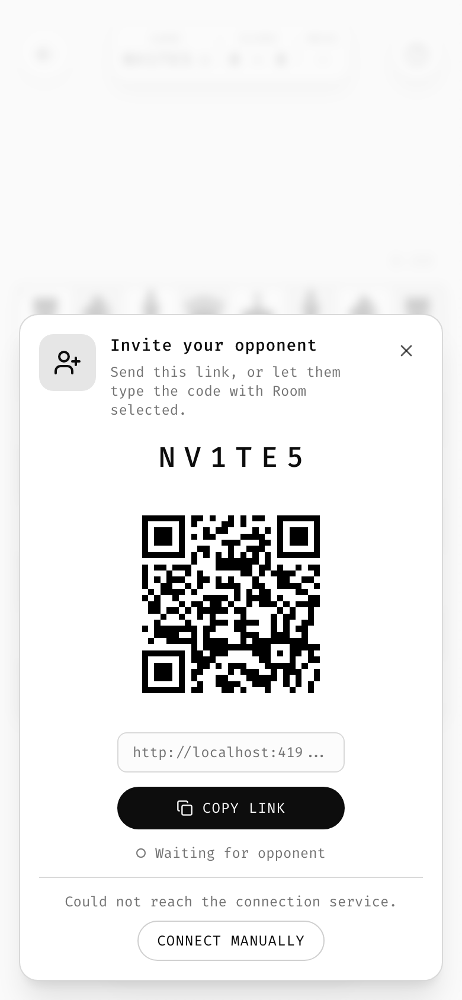

# 18 · Rooms

A **room** lets two people play one game on two devices, with no game server and no account. Zhess built the first one; the rules below are phrased for any turn-based izzardry game. A game without a second-device mode can skip this chapter.

## Principles

- **No server holds the game.** Each device keeps the complete record of every game in the room. A public broker may help two devices find each other; after that, nothing passes through a third party.
- **The code is the room.** The [game code](11-persistence-and-sharing.md#codes-for-games-without-generated-content) is the address both devices meet at. A room link carries the code and nothing else.
- **Creating and joining are one action.** Select `ROOM` on the opponent stepper, enter or roll a code, press **Start**. The app finds out whether it is first. Opening an invite link selects `ROOM` and the code and starts at once. There is no separate join flow.
- **A room is a series.** It lasts across games, keeps a running score (`2 – 1½`, from each device's own point of view) and alternates colors on rematch.
- **Say failure plainly.** Some networks will never connect without a relay. Tell the player once, calmly, with the one action that can help, and never spin forever.

## Building blocks

| Piece | Zhess |
|-------|-------|
| Transport | One WebRTC data channel, reliable and ordered |
| Signalling | `peerjs` against the public PeerJS broker; manual link/QR exchange as fallback |
| ICE | Public STUN servers only (Google, Cloudflare). No TURN: PeerJS's default config includes one and is overridden |
| Encryption | WebRTC's own DTLS |
| Abstraction | A `Transport` interface (`send`, `onMessage`, `onState`, `close`) with three implementations: PeerJS, manual, in-memory for tests. The room logic does not know which one is in use. |
| Protocol | Versioned JSON messages (`v: 1`). A peer on another version gets `Your opponent uses another version. Reload to update.`, and the update check runs. |

## Finding each other

The room's peer id is `<game>-<CODE>` (`zhess-K7QW2M`). Only one device can hold an id at a time:

1. On Start, wait a random 0–500 ms, then try to register the room id.
2. If that works, this device is the **anchor**: it waits and shows the invite sheet.
3. If the id is taken, register a random id and **dial** the room id.

Anchor and dialer are transport roles only; they give no authority over the game. Both devices repeat the procedure on every reconnect, so either can become the anchor.

## Seats and the key

The device that creates a room makes a 128-bit random **key** and hands it to the first device that joins. From then on the room is **locked to two devices**: on every connection each side proves it holds the key with an HMAC-SHA-256 challenge-response (WebCrypto). The key is never sent again, never appears in a link, and never leaves local storage except in that first hand-over.

- A stranger who guesses the code of a locked room learns nothing and is dropped.
- A device that lost its storage (new phone, cleared data) asks to **rejoin**. The other player sees one toast, `Opponent is rejoining from a new device`, with **Decline** and **Allow**. Allow sends the key, the seat, the score and every game, and the new device is fully restored. This is the only manual step in recovery, and it is what makes the lock meaningful.
- The two players trust each other. A modified client could lie about its clock; that is accepted and stated in the design.

## Sync: the longest valid log wins

Each game is a log of moves. On every connection the devices compare a short summary (game number, takeback epoch, length, hash) and reconcile:

1. The higher game number wins; the side that is behind receives the games it missed.
2. Then the higher takeback epoch.
3. Then the longer log, if one continues the other. Adopted moves are replayed through the rules engine first; an illegal move aborts the sync with a toast.
4. A finished log beats an unfinished one of the same length.
5. A true fork, which normal play cannot produce, is settled by the creator's copy, with `Game restored from opponent's copy` on both devices.

Consequences for play:

- **Untimed games allow offline moves.** The player to move may move while the other is away; the move is delivered when both are online again. This gives correspondence play with no server.
- **Timed games pause and lock** while disconnected. Both clocks stop, the strips show `Paused`, and play resumes from the last agreed times.
- Each move carries the time its mover used, measured on the mover's device, so both devices derive the same clocks from the log.

## Requests

Takeback, draw offer and rematch follow the quiet request pattern from [feedback](09-feedback.md#requests-from-another-person): an incoming toast with Decline and Accept, a pulsing button on the asking side, no modal. Requests need a live connection. There is no redo in a room, and resigning is final because the opponent has already been told.

## Presence

| Signal | Zhess |
|--------|-------|
| Dot next to the code | Solid `success` = connected · hollow, pulsing = waiting or reconnecting · tap = invite sheet ([components](10-components.md#presence-dot)) |
| Toast on each change | `Opponent joined`, `Opponent connected`, `Opponent disconnected`, `Reconnected`, in one slot |
| Opponent's strip | Dims while they are away |
| Waiting without a seat | A banner, `Waiting for opponent`, after 1 s |

Reconnect by itself: back off 1, 2, 4, 8 … up to 30 s, and try at once on `online`, `focus` and `visibilitychange`. When no path can be found, show once: `Could not reach your opponent directly. Try another network.` with **Connect manually**.

## Manual fallback: link and QR

When the broker can't be reached, or no channel opens within 10 s, offer a ghost button **Connect manually**. Whoever presses it hosts:

1. **Host:** builds the offer, packs it small (essential SDP lines, at most 10 candidates, `deflate-raw`, base64url: 155–230 characters, a QR of version 9–11) and shows it as a link and a QR code: `#/?s=K7QW2M&o=r&x=<offer>`.
2. **Guest:** opens the link; the app shows the answer as a link and QR: `…&y=<answer>`.
3. **Host:** opens the answer link, which hands the answer to the waiting tab through a `BroadcastChannel` and says "return to the game", or pastes it into a field in the waiting tab.

QR codes are dark modules on a white plate in both themes ([color](03-color.md#theme-stable-colours)). Scanning uses the phone's camera app; there is no in-app scanner. The broker and the manual path race, and the first channel to open wins. The manual path uses the same STUN-only ICE, so it helps when the broker is the problem, not when the network is.

## One room, one tab

Guard a live room with the Web Locks API (`zhess:room:<CODE>`). A second tab on the same device opens the game read-only with `This room is open in another tab` and a **Use here** action that takes it over. Without Web Locks, every tab owns the room.

## Testing rooms

- Test the room logic with two room instances over an in-memory transport: join, lock, failed challenge, rejoin allowed and declined, offline move, takeback, draw, rematch, clock pause, version mismatch.
- Test the real channel with two Playwright browser contexts: the manual path (block the broker's WebSocket so only STUN leaves the machine), recovery, an offline move, and the broker path.
- Before a release that touches rooms, play once on two real phones on different networks (mobile data and Wi-Fi). Without TURN, some network pairs will not connect, and only real devices show which.

## Out of scope

Chat, spectators, more than two devices, a TURN relay, ratings. Each would need a server or would add noise; none is part of an izzardry room.
