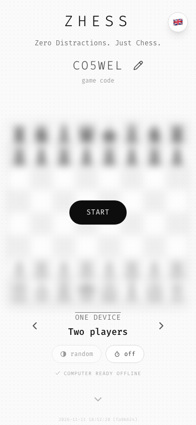
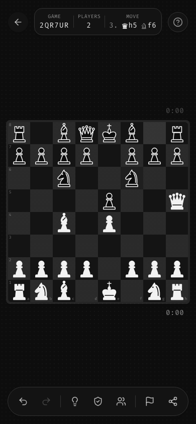
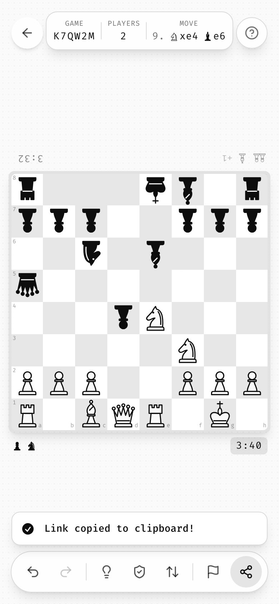

# 91 · Zhess audit

How [Zhess](https://github.com/izzardry/zhess) (as of `a6458ff`, 2026-11-12, live at [izzardry.github.io/zhess](https://izzardry.github.io/zhess/)) relates to Ztyle. Zhess is the second izzardry game and the first built on Ztyle from its first commit: `src/ztyle/` holds verbatim copies of `ztyle.css` and `tailwind.preset.ts` at Ztyle rev `d29758b`. It is a chess game with three modes (computer, two players on one device, a room for two devices), so it tested the guide well beyond a solo puzzle.

## Applied as written

- **Tokens and preset** copied unchanged; game tokens in `src/index.css` with a `--zhess-` prefix.
- **Every fix from the [Zudoku audit](90-zudoku-audit.md)** built in from the start: Fira Code bundled (`@fontsource`, 300–700), one mono stack, dark mode following the system, per-scheme `theme-color` and a `#0d0d0d` manifest, real PNG icons with a maskable variant, the brand focus ring, blurred `background/80` scrims, pill buttons in the install sheet, cell fills as overlays, a working × on undo toasts, `zhess:<key>` storage, every string and aria-label translated, `<html lang>`, reduced motion, arrow keys, a Ztyle 404 page.
- **Brand:** `ZHESS` wordmark, `Zero Distractions. Just Chess.` everywhere, `author` = `izzardry`, icon and OG image to the [brand standard](01-brand.md#app-icon), `an izzardry game` footer.
- **The stage:** one route, the board centered, the blurred preview with the Start pill, floating glass chrome with safe-area insets, tap-background-to-hide, portrait and mobile-landscape rails.
- **Interaction:** the long-press ladder tiers and click suppression, the radial dial (reused twice), the code field, the stepper, `active:scale-95`, `select-none`, swipe and hover delete.
- **Feedback:** one helpers shield, on by default; tap for a hint and hold to peek; page tint plus overlay; undo toasts instead of confirmations; the spinner in place with real progress; synced error pulse.
- **Data and platform:** `s`/`d`/`p` in a `HashRouter` URL written with `replace`, autosave on every move, the last 100 games, the 15-second rule, five recent cards plus `N more games`; network-first HTML, hourly update check with a Reload toast, the version stamp, the install sheet and pill, GitHub Pages with `base: "./"`.
- **Words and respect:** EN, DE (du), FR (vous), ES (tú); the 12-level ladder reused for computer strength (default 5); one donation ask after the first win, 1.5 s later, `maybe another time`; a coach-mark tutorial of six bubbles; the 3 s help-button easter egg.

## Extended: new general rules

What Zhess needed and Ztyle didn't yet say. Each one is now a general rule in the guide.

| Rule | Zhess | Now in |
|------|-------|--------|
| Theme-stable colours | White pieces are filled with the lighter ink, black with the darker one, in both themes; the outline follows the surface. QR codes stay dark on white. | [03](03-color.md#theme-stable-colours), tokens `--ink-light` / `--ink-dark` |
| Light cells stay lighter | The `foreground/10` overlay moves from the dark squares (light theme) to the light squares (dark theme). | [03](03-color.md#two-tone-patterns), tokens `--checker-light` / `--checker-dark` |
| State fills at half the step | Last move and selection use `foreground/5`, so a highlighted square never matches the other tone. | [03](03-color.md#state-fills-at-half-the-step), [09](09-feedback.md#two-tone-boards) |
| Glows are not clipped | The hint layer sits above the neighbouring squares; the grid doesn't clip; the corner squares carry the rounding. | [06](06-surfaces.md#corners-and-clipping), `.cell--hint` |
| Board sizing with a measured reserve | `clamp(34px, min(11.5vw, 10vh, calc((100dvh - 14rem) / 8)), 96px)`; the 14rem was measured. | [05](05-layout.md#board-sizing) |
| The preview may shrink, the layout may not | `previewFit` scales the blurred board to clear the start chrome and grows it back on Start. | [05](05-layout.md#board-sizing), [07](07-motion.md) |
| Board-edge strips | Clocks, captured pieces and material per player, at that player's board edge. Clocks stay when the UI is hidden. | [05](05-layout.md#board-edge-strips) |
| Face-to-face seating | Pass-and-play draws the far side upside down on touch devices; side by side with a mouse. | [05](05-layout.md#two-players-one-device) |
| Start screen with several modes | One opponent stepper across modes, option pills that cycle and open the dial on hold, a Start pill whose label follows the code. | [10](10-components.md#opponent-stepper), [08](08-interaction.md#selectors) |
| Large asset in the background | The engine downloads after the first paint into a runtime cache, with a status line (`Computer 43%`, `Computer ready offline`). | [12](12-platform-pwa.md#large-assets), [10](10-components.md#status-line) |
| Toolbar slots per mode | A fixed row of slots; each mode fills or hides them. | [10](10-components.md#slots-per-mode) |
| Guard, don't ask | A losing move bounces back once with a red pulse; repeating it confirms. | [09](09-feedback.md#guard-dont-ask) |
| End of game against an opponent | Tint from the device player's point of view; no tint for draws or pass-and-play. | [03](03-color.md#semantic-color-usage), [09](09-feedback.md#end-of-game) |
| Requests and presence | Incoming request toasts with Decline/Accept, a pulsing button for outgoing ones, one slot for presence toasts, failure once per cause. | [09](09-feedback.md#requests-from-another-person) |
| Rooms | Two devices, no server: code = room, a seat key, longest valid log wins, manual link/QR fallback, one tab per room. | [18](18-rooms.md) |
| Keyboard twin for holds | Holding `Space`; `Shift+Enter`, `Shift+F10`, `ContextMenu`. | [08](08-interaction.md#keyboard-twin-for-a-long-press) |
| Radial dial beyond cells | Promotion (4 items, aim zone commits), clock (two steps, 9 per ring, caption chip). | [08](08-interaction.md#radial-dial-signature) |
| Glyphs in text | Figurine notation with the board's own SVG pieces; plain letters for screen readers and PGN. | [04](04-typography.md#glyphs-in-text) |
| Reduced-motion fallbacks for pulses | The hint and the blunder mark show still for 1.6 s instead of vanishing. | [07](07-motion.md#reduced-motion), `ztyle.css` |
| Board semantics | `grid` of labelled `gridcell`s, roving tabindex, moves announced in words. | [16](16-accessibility.md#board-semantics) |
| Split i18n tables | Eight per-area tables; the type system keeps DE, FR and ES complete. | [14](14-copy-and-i18n.md#splitting-the-table) |
| Testing as shipped | Playwright against `vite preview`; screenshots at 5 sizes × 2 themes. | [17](17-tech-stack.md#testing) |

## Deviations

Where Zhess does something other than the guide said, and what happened to each.

| # | Deviation | Where in Zhess | Verdict |
|---|-----------|----------------|---------|
| 1 | 7 toolbar buttons in pass-and-play (guide: ≤ 6) | `StatusBar.tsx` | **Guide updated:** aim for 6, hard limit 7 at 44 px on 320 px |
| 2 | Toolbar buttons 44 px on every device, spacing shrinks instead | `toolbarLayout.ts` | **Adopted** |
| 3 | In-game toasts above the toolbar, bottom right; beside the board in landscape (guide: bottom center) | `ui/toasterPlacement.ts` | **Guide updated** |
| 4 | Grey state fills at `foreground/5` (guide: selected `/10`) | `board/Square.tsx` | **Adopted** for two-tone boards |
| 5 | Info pill shows code, opponent, move; clocks moved to the board-edge strips | `game/InfoPill.tsx` | Within the rule (≤ 3 stats); strips **added** |
| 6 | The blurred preview is drawn smaller on short screens | `start/previewFit.ts` | **Guide updated:** layout box fixed, transform allowed |
| 7 | History thumbnails 96 px (guide: 120) | `platform/GameCard.tsx` | **Guide notes** 96 px for 320 px phones |
| 8 | History times are relative (`now`, `5 min. ago`) via `Intl.RelativeTimeFormat` (guide: time of day or `MMM d`) | `platform/history.ts` | **Open:** pick one for the catalogue |
| 9 | Buy Me a Coffee button drawn locally, no CDN image | `platform/SupportButton.tsx` | **Adopted** |
| 10 | URL letter `t` = time control (Zudoku: elapsed seconds); new letters `o`, `w`, `m`, `r`, `x`, `y` | `lib/url.ts` | **Guide updated:** only `s`, `d`, `p` are shared |
| 11 | Cancelling the share sheet copies nothing (Zudoku copies) | `game/useShare.ts` | **Adopted** |
| 12 | No automatic reload mid-game after an update | `hooks/useSWUpdate.tsx` | **Adopted** |
| 13 | Donation ask after the first **win** | `hooks/useDonationPrompt.ts` | **Adopted** for games with an opponent |
| 14 | `foreground/25` for move-target markers, not on the ladder | `board/Square.tsx` | **Added** to the ladder |
| 15 | `strict: true` TypeScript (Zudoku: off) | `tsconfig.app.json` | **Adopted** |
| 16 | Share toast reads `Link copied to clipboard!` (guide: `Link copied!`) | `game/useShare.ts` | **To fix in Zhess** (the shorter key already exists) |
| 17 | Version stamp bottom center on phones; back-to-top can cover the last credit line | start screen | Inherited from Zudoku; **open, cosmetic** |

## Contradictions found in Ztyle, and how they were resolved

1. **Mirror tokens vs. identity.** Chapter 03 said light and dark are mirror images. For chrome that is right; for pieces it turned white black. → Theme-stable inks, a new section and tokens.
2. **Selected fill = checker step.** A `foreground/10` selection on a `foreground/10` checkerboard makes a light square look dark. → Half-step rule for two-tone boards.
3. **The hint recipe clipped its own glow.** `.cell--hint` had no z-index, so later cells covered its 8 px ring. → `z-index: 41` in `ztyle.css`, and the no-clipping rule.
4. **Reduced motion removed information.** The global 1 ms rule made the one-shot hint pulse invisible, against "never color only" and "hints are free". → A still fallback in `ztyle.css` and in chapter 07.
5. **The workbox snippet wasn't network-first.** The precache route answered `./` before the NetworkFirst route. → `directoryIndex: null`, `navigateFallback: undefined`, `precacheFallback` in chapter 12.
6. **Root-relative manifest icons broke `base: "./"`.** → Relative icon paths.
7. **Relative `og:image`.** Crawlers don't resolve it. → Absolute URL plus `og:url`.
8. **Toasts at the toolbar's inset.** The safe-area table put bottom toasts where the in-game toolbar is. → Toasts sit above the toolbar in game.
9. **Board sizing ignored the chrome.** `min(Nvw, Nvh)` alone let the board run under the strips and toolbar on desktop. → A measured height reserve.
10. **"Every gesture has a keyboard equivalent"**, but long presses had none. → Keyboard twins in chapter 08.
11. **"No icon" on system toasts** while the example used `toast.success`, which draws one. → The check is allowed; no other icons.
12. **"Every puzzle has a code"** assumed generated content. → Codes as the game's name and the room's address (chapter 11, rule 8 in the README).

## For the owner

- Re-copy `tokens/ztyle.css` and `tokens/tailwind.preset.ts` into `src/ztyle/` at the new Ztyle revision. Nothing in Zhess breaks: the new tokens (`--ink-*`, `--checker-*`) don't collide with `--zhess-*`, and `.cell--hint` isn't used. Zhess may then replace its four `--zhess-ink-*` / `--zhess-sq-*` variables with the Ztyle ones.
- Fix deviation 16 and decide 8.
- Not yet verified on real devices: two phones on different networks, the installed iOS PWA with the manual fallback, Safari and Firefox in general (e2e runs Chromium only).
